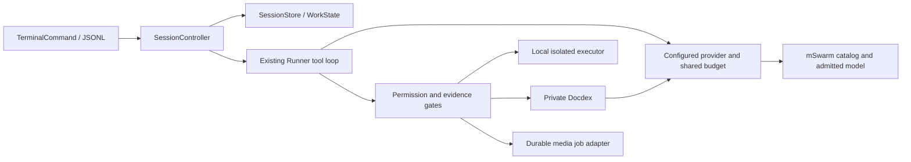

# Codali terminal architecture decisions

Recorded 2026-10-26 against the `feat/codali-terminal-cli` implementation. These
decisions describe the implemented boundaries; they do not certify production
rollout. The [accepted build plan](codali-terminal-build-plan.md) defines scope,
and [build status](codali-terminal-build-status.json) records outstanding gates.

## ADR-001: local execution, remote configured inference

The CLI executes repository tools on the machine where it runs. Models are
reached through trusted user/deployment configuration. An mSwarm API key grants
remote service access; it does not grant local shell or filesystem permission.
Running over SSH uses the same local executor on that SSH host.

`TerminalCommand` creates `SessionController`; the controller uses the existing
`runCodaliTask`/`Runner` tool loop. `ConfiguredProvider` resolves declared models,
and `PermissionGate`, `ToolRegistry`, and the isolated executor mediate tools.
The terminal does not nest `SmartPipeline` or `CodaliGateway` as another outer
planner. Embedded hosts retain those entry points through configured adapters.

This reuses existing provider/tool contracts without making a remote worker the
owner of a user's checkout. Hosted workspaces remain outside first-release scope.

## ADR-002: one goal owner and one writer

For standalone work, versioned `WorkState` is authoritative for the original
objective, requirements, constraints, non-goals, decisions, phases, dependencies,
attempts and completion evidence. Conversation summaries and Docdex memory are
retrieval aids; neither may replace these records. Claims bind goal/plan revision
and allowed paths. A worktree has one writing task; helpers return read-only
results or drafts and cannot authorize tools or declare completion.

For an attached mcoda project task, the existing project task database remains
the owner of its backlog and review status. The terminal plan describes execution
inside that parent task. `ProjectTaskAuthority` fences claims against canonical
revisions and submits verified execution to `ready_to_code_review`; mcoda review
and QA remain required. A durable outbox makes lost handoff responses replayable.

Alternative rejected: a second independently mutable task backlog in the CLI.
See `WorkState.test.ts`, `SessionController.test.ts`, the project authority tests,
and `TerminalRecoveryJourney.test.ts` for dependency, steering, stale evidence,
handoff and restart contracts. Multi-hour live qualification remains open.

## ADR-003: durable state before optimistic progress

Reuse `SessionStore` rather than add another application database. Session
metadata and canonical work state use atomic JSON replacement with file and
directory synchronization. JSONL records carry event identity, sequence and
outcomes. SQLite transaction locks provide process-owned serialization; these
short storage locks are not held across inference. Workspace execution uses a
separate ownership lock and a fence for uncertain side effects.

`WorkState.schemaVersion` is 1; additive phase/history fields preserve the initial
flat-plan representation. Unsupported versions fail explicitly. Pending tool
intents survive restart and must be reconciled before another turn. A completed
media receipt can prove an already-written artifact without rendering again.
Fresh file hashes fence test evidence and project submissions.

Four independent Node processes have exercised a competing work revision: one
update commits, three report conflicts, and all session/transcript records remain.
Flat v1 records retain goal identity, decisions, evidence, checkpoints and unknown
extensions when phases are added. Future work schemas are rejected without
overwriting their records. `SessionDurability.test.ts` records these checks.

An isolated release-reader check covers legacy 0.1.134 transcripts and task-aware
rollback to the exact published 0.1.135-codali.11 artifact. Version 0.1.134 predates
`WorkState`: it can read the transcript but cannot resume terminal task execution.
Do not run that legacy writer concurrently against an upgraded session. Preserve
the session files and use a compatible task-aware client for work continuation.
Broader crash and retention qualification remains open; these checks do not cover
every storage or power failure.

## ADR-004: one versioned model configuration

`OrchestrationConfig` is the common schema/loader for terminal, configured legacy
CLI, public API, jobs, gateway and cognitive-pipeline adapters. Explicit CLI
configuration overrides `CODALI_ORCHESTRATION_CONFIG`, which overrides the
user-level `~/.codali/orchestration.json` default. Models, roles, fallbacks,
modalities, context limits, effort, task policy and private Docdex identity are
declared there. Configuration contains credential references, not secret values.

Catalog discovery filters declared models against entitlement, health and
capabilities; it cannot enroll a new route. Backend restrictions survive role
aliases. Raijin and Suku are both eligible Strata hosts. A host name or friendly
model alias alone is not weight attestation. Embeddings additionally pin artifact,
dimensions and preprocessing; changing that space requires a separate index.

Reload occurs between turns and revokes old grants. In-flight jobs retain their
original provider/model/configuration. `ConfiguredModelScope` makes embedded
role calls share reservations, deadline and cancellation. Production application
call sites still require migration and verification; legacy compatibility does
not prove they use the new profile. The detailed entry-point map is in
[`ORCHESTRATION.md`](../packages/codali/ORCHESTRATION.md).

## ADR-005: credentials and repository trust

Reuse the existing credential resolver and user credential file. Environment
credentials take precedence; login/logout rotate only the mSwarm entries and
preserve unrelated credentials. Interactive entry masks input; automation reads
stdin. Writes use a private temporary file and atomic replacement. Diagnostics
and streams redact known secret values and token patterns.

Repository instructions may guide implementation but cannot install connector
commands, supply operator credentials or widen endpoint trust. API hosts supply
authenticated caller identity and approved configuration through trusted
dependencies. The credential and run-context tests enforce that distinction.
Local permission grants remain separate from remote account entitlements.

## ADR-006: permission policy plus OS isolation

`PermissionGate` provides allow/deny/ask with scoped grants and immediate checks
before side effects. Existing source changes also need current reads, structural
analysis and impact receipts. `prepare_edit` batches those inspections; it is
not an editing or permission bypass. The workspace ledger protects pre-existing
user work, and test/review evidence binds the actual file hashes.

Linux uses bubblewrap and macOS uses sandbox-exec. Shell commands default to a
read-only workspace, private temporary storage and no network; writes require
declared allowed paths. Host toolchain discovery exposes qualified executables
without mounting the user's home. An executable allowlist alone is insufficient.
Missing isolation fails shell execution; native Windows is deferred.

The platform workflow requires a working backend before running the shell suite
on Node 20/22 and Linux/macOS. General unit CI can report unavailable integration
prerequisites explicitly. Passing a unit mock does not qualify an OS boundary.

## ADR-007: deterministic terminal inspection, bounded model work

Interactive terminals use the dedicated `cli/tui` screen, input editor and event
renderer. The accepted 2026-10-28 requirement replaces the initial readline-only
presentation with a full TUI. Explicit plain mode and JSONL remain available.
The UI is an adapter over the existing SessionController, permission gate and
canonical work state; it owns no execution loop, credentials or task authority.
Status, usage, permissions, goal, decisions, tasks and effective configuration
read controller state without inference. Steering updates canonical state;
cancellation distinguishes a request from a confirmed remote stop. The renderer
restores terminal mode and escapes untrusted terminal control sequences.
Approval dialogs keep the full arguments scrollable, default to denial and take
priority over late inspection results. Pasted content never accepts an approval.

Effort selects explicit shared call/tool/token/time limits. Native model reasoning
parameters are enabled only for qualified adapters. Unknown usage remains marked
estimated. Helpers and reviewers spend the same task budget. No optional helper
is promoted solely because its weights fit idle GPU memory.

## ADR-008: private retrieval and durable media

Setup selects a qualified embedding contract and a release-pinned private Docdex
artifact. Archive and native-binary checksums, `runtime-info` capabilities and
private cache permissions are checked before launch. Private daemon state stays
outside the checkout. Docdex inference goes through the controller's configured
model/embedding boundary; deterministic profile storage makes no hidden LLM call.

Image, audio and video tools use declared operation limits and durable client job
IDs. Lost responses are reconciled by identity; uncertainty never authorizes a
second render. Artifact receipts bind source job, model, configuration, format,
size and checksum. Physical GPU admission and native-process recovery are server
responsibilities, not claims the CLI can infer from an HTTP timeout.

The packaged Docdex manifest pins the qualified v0.2.100-codali.2 Linux x64 and macOS x64/arm64 artifacts; clean installs passed on Node20 and Node22.
Backend durable-media/embedding changes and physical media scheduling still need
production activation and mixed-tenant tests before the out-of-box promise is met.

## Evidence and release ordering

The dependency order is shared contracts/configuration, durable controller and
permissions, configured retrieval/media adapters, backend/node capability rollout,
packaged setup, tenant migrations, then mixed-load/canary qualification. Platform
and deterministic fault tests can run before deployment. Frozen live evaluations
must finish before any pinned service is replaced.

Release status is never inferred from a successful model response. Required tests,
fresh evidence, independent review, no unresolved side effects and the completion
gate determine task completion. Published artifacts and production checks are
separate evidence from source tests. Failures and failed candidate tags remain in
the record; reruns after a fix are diagnostic or new candidate runs, not unseen
held-out results.
