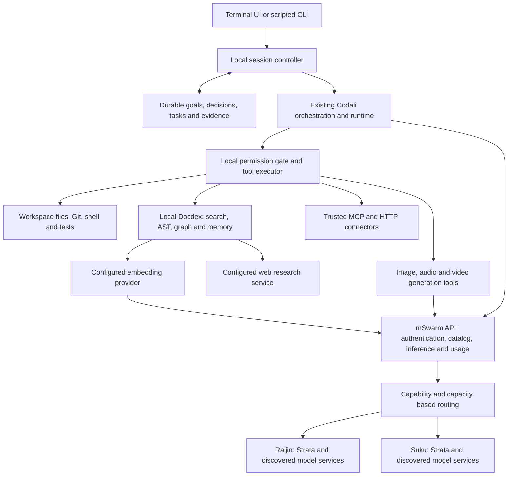

# Codali terminal CLI: phased build plan

Date: 2026-10-25. Status: accepted for implementation on 2026-10-25; progress and evidence are recorded in codali-terminal-build-status.json.

Code baseline: mcoda / @mcoda/codali 0.1.134, commit d6ae58e. This plan extends the existing Codali package. It supersedes older terminal-specific assumptions in codali_architecture_plan.md and codali_build_plan.md only where current source or the requirements below differ; it does not replace the embedded-product gateway design.

Deployment topology, updated from the user's corrections: Raijin and Suku both run Strata, with additional smaller, embedding, audio-generation, image-generation and video-generation models available across the boxes. All model bindings come from a shared versioned configuration file; discovered capabilities determine which configured instances can execute each task. Exact model IDs, versions, placement and capacities are inventoried in Phase 0.

## 1. Product decision and first-release scope

Build a terminal coding agent that a user installs, authenticates with an mSwarm API key, and runs inside a repository. It understands the repository through Docdex, plans and edits code, runs commands and tests, explains progress, accepts steering, and resumes interrupted work. The same runtime must continue to support noninteractive CLI commands and embedded applications.

Recommended first-release assumptions, pending product preference: local workspaces; Linux and macOS; terminal and scripted usage; existing npm package and executable. Native Windows and managed remote workspaces follow after the execution boundary is stable. Running the CLI over SSH on a server remains possible with the same local-executor design.

The core user requirements are fixed:

- Authenticate inference and eligible managed services with an mSwarm API key. Do not require an OpenAI or Anthropic subscription.
- Use Strata on either Raijin or Suku for large-model work, and eligible smaller models on either host for offloading. Discover embedding models as a separate retrieval capability. Retired non-Strata large-Qwen routes remain excluded; hostname alone does not determine eligibility.
- Include Docdex repository search, symbols, AST, impact analysis, web research, and scoped memory in the normal workflow.
- Use the installed audio, image and video creation models for relevant tasks through the same orchestration and tool system. These capabilities are part of the first stable release.
- Declare every orchestration model and fallback in a versioned configuration file that CLI and embedded applications share. Other deployments can select different supported models and future revisions without editing orchestration code.
- Evaluate additional smaller specialist models only where they improve a measured workload and fit the available GPU or unified-memory capacity under realistic concurrent load.
- Provide interactive status, usage, permissions, model/route visibility, and selectable effort.
- Preserve the main objective across long sessions, compaction, restarts and delegation. Make requirements, architecture decisions, phases, task dependencies, scope changes and completion evidence explicit; keep the repository maintainable and protect existing user work.
- Keep the orchestration and tool system useful out of the box, with a short, explicit setup flow.

Defer a hosted workspace service, a new generic scheduling platform, IDE extension, browser automation suite, plugin marketplace, full media editing studio, and automatic paid-provider fallback. Terminal-driven media creation, job tracking and artifact delivery are in scope. Existing connectors and capabilities continue to work; these are limits on new first-release work.

## 2. What exists and what needs extending

| Area | Verified starting point | Work needed for the terminal product |
| --- | --- | --- |
| Packaging / entry point | packages/codali/package.json already publishes @mcoda/codali and a codali executable. cli.ts exposes ask, run, fix, review, explain, test, tools, serve, and other commands. | Interactive default for a TTY, stable scripting entry point, real package version instead of the current dev output, installation and compatibility tests. |
| Runtime | runtime/CodaliRuntime.ts has tool execution, policy inputs, streaming callbacks, usage events, sessions, and subagents. | One reusable interactive controller, cancellation throughout, approval request/reply, stable events, and task-wide budgets. |
| Orchestration | gateway/, cognitive/SmartPipeline.ts, agents/, and existing CLI command paths already implement planning, routing, evidence, and review. | Trace the entry paths and select one outer lifecycle owner. Adapt existing stages; prevent nested unbounded orchestration loops. |
| Work planning and state | runtime/CodaliJobRuntime.ts has stage goals, dependsOn and budgets; gateway/CodaliGatewayStore.ts has run/task/evidence records. mcoda TaskOrderingService has topological sorting/cycle checks; TaskStateService records transitions. | Add versioned goal/requirement/decision records, durable task dependencies, guarded transitions and evidence-based completion through one authoritative state owner. Map existing mcoda task IDs when attached to a project; avoid a competing backlog. |
| Providers | ProviderTypes.ts defines requests, streamed output, responses, tool calls, and token counts. Provider adapters already exist. | Normalize cancellation, capability declarations, usage provenance, and optional native reasoning controls. Validate capability claims against live adapters. |
| Tools / policy | ToolRegistry validates arguments. Runtime exposes write/shell/outside-workspace policy. RunContextResolver rejects repository-supplied connector commands, endpoints, and credentials. | Central approval gate and executor controls across every route. Preserve the existing repository trust boundary. |
| Shell | tools/shell/ShellTool.ts uses spawnSync, an executable allowlist, and destructive-command heuristics. | Asynchronous output, child-process lifecycle, cancellation, time/output limits, and OS isolation. An executable allowlist is not a sandbox. |
| Sessions | session/SessionStore.ts has schema-v1 metadata, JSONL transcript events, summaries, resume bundles, and parent session IDs. Default storage is .mcoda/codali/sessions. | Durable event identity, crash recovery, permission/usage records, concurrent-writer protection, and explicit migration. Reuse this storage before considering another database. |
| Credentials | runcontext/CredentialFile.ts reads user-level ~/.codali/.creds with environment precedence; it deliberately ignores workspace credential files. | mSwarm login/logout, secure storage, key rotation, secret redaction, and backward-compatible migration. |
| Docdex / connectors | docdex/DocdexClient.ts, MCP/HTTP connectors, tool manifests and health commands exist. | Local bootstrap, lifecycle/version diagnostics, fresh indexing, consistent permissions, and useful degradation behavior. |
| Media | connectors/media/ImageGenerationTool.ts already exposes image creation as a tool and returns artifact references. shared/src/llm/GenerativeOperation.ts defines image, audio and video generation operations. | Reuse those contracts; audit the existing mSwarm media paths and add missing terminal/runtime audio/video integration, durable jobs, resource budgets and safe artifact delivery. Generation is not automatically permitted because the existing image tool is marked readOnly. |
| Model configuration | RunContextResolver, agent inventory and provider configuration already resolve per-host/application settings. | One versioned orchestration schema and loader shared by CLI and embedded applications; explicit bindings for all text, retrieval and media models, with validation, configuration provenance and upgrade/rollback. |
| mSwarm | Gateway source exposes runtime/usage-limits, agent discovery, self-hosted load-balanced invocations, invocation inspection and cancel, plus managed Docdex/web endpoints. | Reuse these APIs. Audit whether they expose all needed streaming, capability, quota, routing, and cancellation semantics; extend only gaps. Endpoint existence is not proof of complete behavior. |
| Quality tooling | Evaluation, replay, regression, and live Suku harness components exist. | Extend live coverage to both Strata hosts, smaller and embedding models; add a terminal workflow corpus, offloading comparisons, PTY tests, and production coexistence gates. |

The older build plan's claims that Codali has no ask entry point or MCP client are stale. Do not reopen those as greenfield projects. README behavior also needs reconciliation with current CLI defaults.

Docdex inspection limitation: the impact query for CodaliRuntime.ts returned an empty graph despite visible imports. That is incomplete graph evidence, not proof of isolation. Phase 0 must repair/reindex coverage and cross-check direct imports and call sites before changing shared code. The retrieved DAG documents research flow, not a complete TypeScript dependency graph.

## 3. Architecture and execution boundaries



The local process owns session state, tools, permissions, cancellation, context assembly, and the outer task budget. Strata on either Raijin or Suku performs demanding model reasoning through mSwarm. Neither host needs a mount of the user's repository. Local tools inspect the current checkout, including uncommitted files, and supply bounded relevant evidence to inference. Docdex can use a configured embedding provider from either host through an authorized, compatible transport; its repository index and file access remain local in the default workspace mode.

Inference requests for this mode must not launch a second remote autonomous tool loop. A tool call returned by a model is a proposal; the local runtime validates and executes it. Existing server-side Codali application jobs remain supported through their host-supplied RunContext. Share contracts and implementation without forcing all products through a terminal session service.

An mSwarm key grants only its account's inference/service entitlements. It does not grant shell access to Raijin or Suku. A future remote-workspace mode needs a separately authenticated executor and workspace ownership model. Do not require inbound callbacks to a user's laptop for the first release.

Keep the runtime headless. The terminal renders events and sends commands to it; it does not own model prompts, routing rules, or tool policy. The scripted interface uses the same controller and policies. Both consume the same validated orchestration configuration. Raijin/Suku names, Strata requirements and concrete model IDs belong in this deployment's configuration, not in reusable engine conditionals.

Proposed implementation boundaries inside packages/codali/src, with final filenames decided in Phase 0:

- terminal/: input, rendering, command palette, status, approvals and diff views.
- runtime/: session controller and versioned events extending CodaliRuntime.
- providers/ and agents/: mSwarm transport, capability normalization and existing role selection.
- permissions/: policy evaluation and permission decisions, integrated with existing gateway policy.
- tools/shell/ and runtime/: async process execution, isolation adapters and workspace locks.
- session/: existing persistence plus event/receipt/usage extensions.
- docdex/, connectors/, cognitive/, gateway/: reuse and targeted integration changes.

Do not create one package per concept or a second tool registry. Choose the terminal renderer after a short PTY prototype comparing the existing Node approach with a terminal UI library; judge input correctness, scrollback, accessibility, CPU use, dependency cost and testability.

## 4. Configurable routing, offloading, retrieval and media

Use three understandable text-generation roles, backed by the existing role resolver, plus separate retrieval and media capabilities. The placements below describe this deployment's configuration; other systems may supply different compatible model bindings:

| Role | Default execution | Scope |
| --- | --- | --- |
| Lead | Eligible large model served by Strata on Raijin or Suku | Task interpretation when substantive, planning, difficult implementation, integration decisions, final synthesis. |
| Helper | Healthy eligible smaller model on either host | Bounded classification, extraction, query suggestions, summaries and mechanical draft work that pass role-specific evaluations. |
| Reviewer | Eligible Strata model on either host, separate review step | Review changes/evidence and identify gaps on substantive work. This may use the same model as the lead; use a different eligible model when useful and within budget. |
| Embedding service | Compatible embedding model on either host | Document/query vectors for Docdex retrieval and scoped memory. This capability cannot fill a generation or tool-calling role. |
| Image creation | Configured installed image model on an eligible host | Generate requested images/assets; editing or reference-image conditioning only when advertised and tested. |
| Audio creation | Configured installed audio model on an eligible host | Sound effects/music or speech according to the model's actual capability; do not treat audio generation, speech synthesis and transcription as interchangeable. |
| Video creation | Configured installed video model on an eligible host | Generate requested clips with supported duration, resolution, frame-rate and conditioning limits. |

The catalog must distinguish host, serving backend, model ID/revision, input/output modalities, supported operations, context/output limits, supported tool/structured-output formats, native reasoning controls, health, entitlement and physical resource pool. Embedding entries additionally identify dimensions, normalization, tokenizer/preprocessing and a compatible embedding-space version. Media entries identify accepted inputs, generation/editing modes, output formats, dimensions, duration/frame/sample-rate limits and synchronous versus asynchronous operation. Discovery validates the configured model set; it cannot silently enroll arbitrary new models. Do not assume the same models or capabilities on both boxes merely because both run Strata.

Filter first by entitlement, role quality threshold, required capabilities and request limits; then choose among eligible instances using available capacity, queue delay and measured latency. A session may prefer a warm model instance, but affinity must not prevent safe failover. Record the selected host, backend, model/revision and route reason for each request.

Small helpers receive a complete capsule: objective, exact evidence, file/symbol references, permitted output, limits, and success criteria. They do not receive the entire conversation or credentials. Start helpers as read-only/draft-only. The lead validates their claims against source and tests before applying a patch. A failed or low-confidence helper result escalates within the shared task budget; it cannot lower the verification requirement.

Docdex delegation and any remote worker that invokes another model must inherit the same parent identifiers, routing exclusions and budget. If an adapter cannot expose or enforce nested usage, disable autonomous nested delegation for that path until the contract is extended. Otherwise an apparently bounded helper could create another unbounded orchestration loop.

Do not pay the latency of a multi-stage pipeline for every short exchange. Deterministic slash commands use no model. Safe, bounded lightweight questions may use a qualified helper; coding tasks and uncertain answers escalate to an eligible large Strata model on either host. The route and reason must be visible in the trace.

Routing is enforced on resolved backend identity/capability, not only a friendly alias. Exclude the retired non-Strata large-Qwen routes through direct selection, pool expansion, fallback and stale catalog entries. A current Strata-served model on Raijin is eligible when it meets the role requirements; do not reject it solely because of its hostname or a model-size string. If either host is unavailable or saturated, select a compatible entitled instance on the other host. Recheck context, tool schema, reasoning and quality requirements before changing models; queue or checkpoint if no valid route remains. Never silently revive a retired route, lower required capabilities or use a paid provider.

Reuse mSwarm scheduling across both hosts. Measure concurrency, context limits, loaded-model residency and physical accelerator/resource groups per deployment; older single-Suku slot/context observations are not fleet defaults. Count capacity by physical serving pool so aliases do not manufacture GPU slots. Account for contention between large, smaller, embedding and media models sharing hardware, including loading latency and video/image peak allocations. Reserve bounded interactive/retrieval capacity; queue heavy renders when necessary so media and background indexing cannot starve current users. Do not unload an in-use model or assume a remote render is preemptible without backend support.

Embedding routing must preserve the index's embedding space. Document and query vectors must use compatible model revision, dimensions and preprocessing. Failover is safe only to a verified compatible replica; equal vector dimensions alone are insufficient. Changing embedding spaces requires a versioned rebuild with an atomic index switch, not mixing old and new vectors. If no compatible embedding route is available, keep lexical/AST tools usable and explicitly mark semantic retrieval unavailable. Support bounded embedding batches, input limits, cancellation and separate usage accounting.

Use per-tenant admission and bounded queues so CLI traffic coexists with TNL, BDYA and Logmira's Wodo/Heka tenants. Show queued versus generating distinctly. If priority classes are introduced, use weighted fairness with a bounded starvation policy. Production protections must be measured and enforced, not implemented as a CLI-only sleep.

### 4.1 Shared orchestration configuration

Provide one schema-versioned JSON document, provisionally orchestration.json, with one shared loader used by the CLI, the embedded runtime and background jobs. Trusted user/deployment configuration selects the file; embedded hosts may supply the equivalent validated object. Reuse existing credential/config resolution rather than introducing a parallel source of truth. Ship a JSON Schema, a portable example and a Raijin/Suku deployment profile. Exact filenames/flags are finalized in Phase 0.

The document covers provider/adapter references; every concrete model/revision and its approved placement; role/tool bindings; allowed fallback chains; selection policy; effort and task budgets; task-control/delegation/review policies; operation-specific media defaults/limits; embedding-space references; and resource/admission settings. Keep measured availability and capacity in runtime inventory, separate from configured ceilings. Discovery may narrow effective capabilities, never widen account entitlements or permissions.

Every model call must resolve through a declared binding, including classifiers, query rewriting, compaction, memory summarization, tool-JSON repair, reviewers, helpers, optional rerankers/vision/ASR/TTS, embeddings and media generation. Reusing a lead/helper binding is fine, but hidden hardcoded model IDs and undeclared fallback calls are not. Bindings for optional capabilities can be disabled explicitly; missing required bindings are validation errors. Bridge Docdex delegation/embedding and server-worker configuration to the same resolved references so they do not reintroduce hidden defaults.

Illustrative subset of the proposed schema; angle-bracket values must be replaced with inventory-verified identifiers before use:

```json
{
  "schemaVersion": 1,
  "profile": "raijin-suku",
  "providers": {
    "inference": {
      "adapter": "mswarm",
      "baseUrl": "<trusted-api-origin>",
      "credentialRef": "env:<existing-mswarm-key-variable>"
    }
  },
  "models": {
    "large_raijin": { "provider": "inference", "catalogId": "<raijin-strata-model-id>", "revision": "<revision>" },
    "large_suku": { "provider": "inference", "catalogId": "<suku-strata-model-id>", "revision": "<revision>" },
    "helper": { "provider": "inference", "catalogId": "<approved-small-model-id>", "revision": "<revision>" },
    "embedding": { "provider": "inference", "catalogId": "<embedding-model-id>", "revision": "<revision>" },
    "image": { "provider": "inference", "catalogId": "<image-model-id>", "revision": "<revision>" },
    "audio": { "provider": "inference", "catalogId": "<audio-model-id>", "revision": "<revision>" },
    "video": { "provider": "inference", "catalogId": "<video-model-id>", "revision": "<revision>" }
  },
  "bindings": {
    "lead": { "candidates": ["large_raijin", "large_suku"] },
    "reviewer": { "candidates": ["large_raijin", "large_suku"] },
    "helper": { "candidates": ["helper"] },
    "classifier": { "useBinding": "helper" },
    "queryRewriter": { "useBinding": "helper" },
    "compactor": { "useBinding": "lead" },
    "memorySummarizer": { "useBinding": "helper" },
    "toolRepair": { "useBinding": "lead" },
    "embedding": { "candidates": ["embedding"], "embeddingSpace": "<compatible-space-id>" },
    "imageGeneration": { "candidates": ["image"] },
    "audioGeneration": { "candidates": ["audio"] },
    "videoGeneration": { "candidates": ["video"] }
  },
  "routing": {
    "strategy": "capability-and-capacity",
    "requiredBackends": { "lead": ["strata"], "reviewer": ["strata"] }
  },
  "taskControl": {
    "maxWritingTasksPerWorktree": 1,
    "maxConcurrentHelpers": 2,
    "helpers": "read-only-or-draft",
    "repeatedFailureThreshold": 3,
    "repairAttemptsBeforeReplan": 2,
    "checkpointOn": ["task-transition", "before-compaction", "before-exit"],
    "reviewPolicy": "risk-and-evidence"
  }
}
```

Validate unknown fields, missing/duplicate IDs, alias cycles, undeclared candidates, operation mismatches, forbidden fallbacks, provider support and unavailable required capabilities before starting work. A pool alias must resolve only to configured approved model revisions; new pool membership does not silently broaden the model set. Secret values remain in the existing credential store/environment, never in the document. Project settings may select already-approved bindings or narrow limits; they cannot define executable adapters, redirect credentials or override managed restrictions.

Record the resolved configuration version/hash and model provenance on each turn/job. Load updates atomically at turn boundaries after validation. In-flight media jobs retain their original model parameters; resumed sessions explicitly migrate or retain their prior configuration. An upgrade is: change bindings/revisions → validate/diff → run role-specific evaluations and memory-fit checks → canary → promote, with rollback to the prior file. Embedding changes also require the compatibility/reindex process. A supported model swap needs configuration changes; a genuinely new wire protocol can still require an adapter implementation.

Removing a model binding blocks new submissions and explicitly drains or cancels admitted jobs; it cannot silently move them to another model. Keep the original configuration snapshot for reconciliation and artifact retrieval. Current credential/entitlement revocations and tightened security policy override an old snapshot's permissions. Test removal and revocation while a render is queued, running and completed but not yet downloaded.

Acceptance proof: run the same workflow through the CLI and an embedded-host fixture using this deployment profile and an alternate model profile, without source changes. Assert that every provider call references a declared binding and includes its configuration hash. Provide config validation and effective-config inspection commands, with redacted secret references and provenance.

### 4.2 Media jobs and artifact delivery

Expose media creation as ordinary tools in the existing registry, following ImageGenerationTool's design, rather than a separate planner. The lead can combine research, code and media steps: for example, create a landing page, generate its hero image, generate a short audio/video asset when requested, then integrate the files. Do not generate unrelated assets just because a model is available.

Use distinct capabilities for image generation/editing, audio effects/music, speech synthesis, transcription and video generation/conditioning. Map only supported operations and parameters from configuration plus verified inventory; reject unsupported options instead of silently discarding them. A speech request must not be routed to a music-only model. Existing installed models come first; optional new specialists fill demonstrated gaps.

Extend the shared job/event contract for accepted, queued, running, progress-if-reported, artifact-ready, failed and cancel-requested/cancelled outcomes. Support short synchronous responses and durable asynchronous jobs through the same interface. Long renders must remain visible in /tasks, survive CLI disconnects and reconcile before retry or failover. Closing a stream does not prove cancellation. Use idempotency keys where supported, and never automatically repeat an ambiguously completed render.

Return ArtifactRef records with ID, media type/MIME, size, checksum, safe local path or authenticated remote reference, job/session association, model/revision/configuration hash and generation parameters. Keep bytes/base64 outside prompts and transcripts. Download using bounded streaming and atomic writes, validate reported and actual type/size/dimensions/duration, and persist a receipt. Source/reference assets and chained intermediate outputs use scoped references. Expired download URLs need an authenticated refresh path; retention and tenant isolation apply to all artifacts.

Generation and its GPU/cost use require a media capability grant; saving an artifact, overwriting a project asset and publishing externally are distinct actions. The existing image tool's readOnly flag must not bypass these checks. User-requested media work can use the session's authorized media budget without repeated prompts for each routine step. Plan mode may prepare prompts/storyboards but cannot start generation without an explicit mode/capability change. Local playback/opening is explicit; do not launch viewers or upload artifacts automatically.

Define per-task media budgets independently of text effort: number of candidates, pixels/resolution, duration, frames/frame rate, supported sampling controls, output bytes and GPU-time/cost limits where enforceable. /effort may influence planning and permitted refinement passes within those bounds; it must not silently enlarge a video or raise resolution. Surface queue/render/download time separately. Validate decodability and requested technical constraints; only claim semantic/visual/audio review when a qualified inspection tool or human actually performed it.

### 4.3 Smaller specialist models and capacity planning

First benchmark the already-installed models against real tasks. Prefer reusing a competent resident model to adding another process. For software planning and repository work, prioritize the capacity-selected candidates in Section 4.4. Retrieval reranking, visual inspection and speech specialists remain subsequent options where the installed services leave a measured gap. Media generation remains routed to the installed appropriate models; this shortlist does not authorize loading every candidate simultaneously.

Candidate examples for evaluation, not installation commitments or claims of fit:

| Candidate | Potential job | Evaluation decision |
| --- | --- | --- |
| Existing small text models | Classification, extraction, query rewriting and bounded drafts | Measure schema validity, correctness and full-task latency before adding another general small LLM. |
| [SERA-14B](https://huggingface.co/allenai/SERA-14B), Q4_K_M | Repository investigation, bounded implementation plans and software-engineering subtasks | Selected for Suku GPU1 qualification with a 12-GiB process reservation; see Section 4.4. Architecture decisions remain reviewed by the lead. |
| [Qwen3-4B-Thinking-2507](https://huggingface.co/Qwen/Qwen3-4B-Thinking-2507), Q4_K_M | Small planning drafts and task decomposition | Selected for Raijin GPU1 qualification with a 4-GiB process reservation; compare against its already-installed 4B Instruct model. |
| [Qwen3-Reranker-0.6B](https://huggingface.co/Qwen/Qwen3-Reranker-0.6B) | Rerank Docdex search candidates before sending evidence to the lead | Prioritize if better retrieval reduces expensive context without offsetting latency. It returns ranking evidence, not embeddings or tool plans. |
| [Qwen3-VL-2B-Instruct](https://huggingface.co/Qwen/Qwen3-VL-2B-Instruct) | Screenshot/image inspection and basic visual checks of generated assets | Evaluate OCR/inspection accuracy and image-context memory. Vision input support does not imply image generation. |
| [Qwen3-ASR-0.6B](https://huggingface.co/Qwen/Qwen3-ASR-0.6B) | Transcription and subtitle input for audio/video workflows | Add only if existing services do not meet language/accuracy/latency requirements. |
| [Qwen3-TTS-12Hz-0.6B-CustomVoice](https://huggingface.co/Qwen/Qwen3-TTS-12Hz-0.6B-CustomVoice) | Speech/narration when music/effects models do not provide speech | Compare with installed speech services; evaluate language, voice quality and serving-runtime compatibility. |

Recheck current official model cards and serving support when executing the plan. The shortlist can change through configuration; do not make these names engine defaults. Check licenses and exact quantized artifact provenance for the intended deployment. Parameter counts and checkpoint download sizes are not peak GPU-memory measurements.

Inventory both boxes' actual accelerator/backend, dedicated versus unified memory, total/usable memory, current resident allocations, configured context/batch/concurrency, CPU RAM and storage. Capture idle and realistic peak use, including Strata KV caches, vision/audio encoders, diffusion/video temporary allocations, model loading and concurrent tenants. A single free-memory snapshot is insufficient to declare space available.

For each candidate and host, measure warm/cold latency, peak allocated/reserved memory, quality, throughput and whole-task effects under the expected workload. Admission requires existing workload peak + candidate peak + an explicit measured safety reserve to fit the usable device budget, with system-RAM/OS reserve on unified-memory machines. Track shared memory once; two model aliases are not two independent devices. Evaluate on-demand GPU loading when a low-frequency specialist cannot justify permanent residency; Raijin/Suku llama-server candidates must not fall back to CPU execution.

Produce a placement matrix: model/revision/quantization, supported runtime, host/resource group, resident or on-demand policy, tested maximum input/output/batch/concurrency, measured peak footprint, reserve and benefit versus the current route. Install/promote one qualifying candidate at a time during the implementation rollout, add it to configuration and discovery, run mixed text/retrieval/media load tests, and retain a rollback/unload path. Do not evict a required production model to make a benchmark pass. If no candidate provides a useful gain within headroom, the accepted result is no additional installation.

### 4.4 Capacity audit and selected software models

Read-only audit: 2026-10-25, with 16 passive GPU samples per host from approximately 18:08:57 to 18:09:59 UTC. Both hosts have two NVIDIA RTX 3090 cards, each reporting 24,576 MiB (24 GiB) of dedicated VRAM. Free memory stayed constant during this interval; Raijin had existing GPU activity, while Suku was idle. These are current-residency observations, not worst-case render or candidate-load measurements. No models were downloaded, installed, stopped or reconfigured during the audit.

| Host / physical GPU | Observed free VRAM | Placement decision |
| --- | ---: | --- |
| Raijin GPU0 | 1,107 MiB / 1.08 GiB | No additional model. |
| Raijin GPU1 | 6,779 MiB / 6.62 GiB | Qualify the 4B thinking candidate below; keep at least 2 GiB beyond its reservation. |
| Suku GPU0 | 1,051 MiB / 1.03 GiB | No additional model. |
| Suku GPU1 | 16,554 MiB / 16.17 GiB | Qualify SERA-14B on demand; keep at least 4 GiB beyond its reservation and coordinate with media jobs. |

Do not add free memory across cards and treat it as one contiguous allocation. Strata currently spans both GPUs on each host. Raijin also runs Qwen3-0.6B, Qwen3-1.7B, Qwen3-4B-Instruct-2507 and nomic-embed-text; its 4B Instruct service already holds about 5.5 GiB on GPU1 with a 65,536-token configured context. Keep that service intact for existing consumers and as the baseline comparator. Suku runs nomic-embed-text plus SD3.5, Stable Audio 3 and Wan2.2 services. Its image/video processes select physical GPU1 with CPU-resident parameters and GPU computation, so low idle allocations do not imply low render peaks. Strata vision components also consume GPU1 memory on both hosts.

System memory is not an unlimited fallback: at the initial snapshot Raijin had about 46 GiB available RAM with its 8-GiB swap almost full; Suku had about 33 GiB available RAM with about 9 GiB of swap used. This selection does not rely on spilling new model layers or KV caches to system RAM.

| Selected model | Host / GPU | Published Q4_K_M file size | Estimated Q8 KV at 8,192 tokens, one slot | Proposed total process reservation | Role / residency |
| --- | --- | ---: | ---: | ---: | --- |
| SERA-14B | Suku GPU1 | 9,001,753,472 bytes / 8.384 GiB | 0.664 GiB | 12 GiB | Software specialist for repository-grounded plans and bounded implementation tasks. Load on demand; exclude heavy media overlap until tested. |
| Qwen3-4B-Thinking-2507 | Raijin GPU1 | 2,497,281,152 bytes / 2.326 GiB | 0.598 GiB | 4 GiB | Planning/task-breakdown drafts. One slot, initially on demand; allow warm residency only after peak-load and usefulness gates pass. |
| SERA-8B, alternative to SERA-14B | Suku GPU1 | 5,027,783,840 bytes / 4.682 GiB | 0.598 GiB | 7.5 GiB | Smaller fallback candidate if 14B latency, memory peaks or media coexistence fail; do not keep both SERA sizes resident. |

**Qualification update, 2026-10-27:** prioritize SERA-8B for the next Suku specialist qualification. Its verified Q4_K_M artifact passed six existing bounded planning-draft cases with all 37/37 layers on GPU. Observed peak allocation was 5,416 MiB, minimum remaining GPU memory 11,049 MiB, and minimum available host RAM 30,354 MiB. Each draft took 11.1–14.3 seconds; this is not a paired latency comparison or a held-out software-quality result. The candidate was unloaded after each case, the shared media scheduler returned ready, and production Strata/Nomic process identities stayed unchanged.

Keep the 7.5-GiB GPU reservation and 4-GiB GPU guard. The qualification also reserves 8 GiB of host RAM above a 16-GiB host guard and bounds each candidate residency to 120 seconds. SERA-14B remains deferred: one admission snapshot failed its 16-GiB free-memory threshold, while later snapshots barely cleared it. This is not a permanent claim that 14B cannot fit. The Raijin Thinking-4B candidate underperformed the resident Instruct model in its initial screen, so retain Instruct and leave Thinking disabled.

The SERA-8B profile remains disabled for production orchestration. Next, run paired and repeated task-quality checks, actual helper integration, and media/vision coexistence under the existing admission policy. The initial screen alone does not authorize promotion. Evidence and unresolved gates are recorded in `docs/codali-terminal-release-readiness.json` and the build ledger; earlier harness failures remain retained separately.

The file sizes are published artifact metadata, not measured GPU footprints. KV estimates use the official model configurations and the Q8_0 assumption: two caches × layers × KV heads × head dimension × tokens × 34/32 bytes. SERA-14B has 40 layers; the 8B and 4B candidates have 36; all three list eight KV heads and head dimension 128. Alignment, compute buffers, CUDA graphs, attention implementation and allocator behavior add memory. The process reservations include provisional overhead: they are admission targets, not an allocator-enforced cap or proof of successful loading.

At the observed baseline, the primary reservations leave roughly 4.17 GiB free on Suku GPU1 and 2.62 GiB on Raijin GPU1. Require free memory of at least reservation + guard before loading: 16 GiB for the Suku 14B profile and 6 GiB for the Raijin 4B profile. The small margin above those admission thresholds means recheck at dispatch; never start solely because this dated audit passed. If measured peak use exceeds the reservation, revise the profile or reject it instead of borrowing the guard.

Start both primary candidates at 8,192 total context tokens, one active sequence, Q8_0 K/V caches, batch at most 256 and microbatch at most 128; verify these settings with the selected serving adapter. Include generated reasoning/output in the context and task token limits. Begin the 4B draft role with a bounded 2,048-token output allowance and evaluate its end-to-end latency against 4B Instruct; a thinking model is not automatically faster. Do not enable the advertised maximum context or automatic multi-slot concurrency. If the adapter cannot honor the cache/layout assumptions, recompute and measure fit before loading.

Use the existing supported Qwen3-serving path behind mSwarm, subject to template/tool-parser qualification; shared Qwen3 architecture alone does not establish full SERA compatibility. Prefer Strata for these candidates only if it supports their exact artifacts/operations; otherwise the existing llama.cpp secondary-worker adapter is an option. The primary architecture/planning-review lead remains the configured large model served through Strata. This adds bounded specialist roles and does not revive the retired large-Qwen backend.

Pinned evaluation artifacts, with third-party quantization provenance to verify before installation:

| Profile | Artifact source / revision | File SHA-256 |
| --- | --- | --- |
| Suku specialist | [mradermacher/SERA-14B-GGUF](https://huggingface.co/mradermacher/SERA-14B-GGUF), revision ea03e65d0394115a9f83b70ca1f8fcec866196c5, file SERA-14B.Q4_K_M.gguf; base allenai/SERA-14B revision 9b585b4126595e471eae9d2c59c8d73dd0fe9e7b | 86ebc0d6362af75b4d79ddcffd91ac86973a3ba95c82c4e4909d509c993b45d4 |
| Raijin draft planner | [unsloth/Qwen3-4B-Thinking-2507-GGUF](https://huggingface.co/unsloth/Qwen3-4B-Thinking-2507-GGUF), revision f40adb104d4d44aee52f398b60597c5866a973a3, file Qwen3-4B-Thinking-2507-Q4_K_M.gguf; base Qwen/Qwen3-4B-Thinking-2507 revision 768f209d9ea81521153ed38c47d515654e938aea | ddd52e18200baab281c5c46f70d544ce4d4fe4846eab1608f2fff48a64554212 |
| Smaller Suku alternative | [bartowski/allenai_SERA-8B-GGUF](https://huggingface.co/bartowski/allenai_SERA-8B-GGUF), revision 4c69384f86828c5f54a5ac3116450ecafdd099c8, file allenai_SERA-8B-Q4_K_M.gguf; base allenai/SERA-8B revision 359cef1e06dc791ac775bee5dd88073502c93434 | 3df33df4dc90d1dd69ce99b182cfab056b43e87a4f8186b98e247859e124dfda |

The base revisions above identify the official metadata inspected during the audit; they are not an attestation of the quantizer's exact source commit. Validate that relationship, tokenizer/chat template and artifact integrity before use, or produce an internally verified conversion from the pinned official weights. All installation records belong in the shared orchestration/deployment configuration, not hardcoded engine branches. Use stable GPU UUIDs when binding the profiles: Raijin GPU1 GPU-a1953401-3521-1c45-ac35-5df1bf9e1509; Suku GPU1 GPU-efba3357-90f5-5095-b2c4-ea582cb888e6.

Add configuration entries for software_specialist_suku and planning_draft_raijin with these artifact references, host/resource-group affinity, memory reservation, guard, context/cache/batch/concurrency limits and on-demand residency. Keep them disabled until qualification. A task_decomposer binding may use the 4B candidate, and a repository_worker/planning_specialist binding may use SERA; both escalate through the existing configured lead/reviewer. Selecting SERA-8B replaces the SERA-14B binding rather than appending another resident process. Register actual service IDs after provisioning; do not assume the catalog already has these models.

Suku media admission is a prerequisite for enabling its specialist: introduce one shared GPU1 reservation/lease path covering SERA, SD3.5, Stable Audio, Wan and any direct/legacy entry points. A per-service semaphore is insufficient. Drain the specialist's current request, unload its weights/cache, confirm released VRAM, then admit a heavy media job if that job's own capacity check passes. Reload only after the media lease ends and headroom is rechecked. Do not kill an active render or unload the production Strata model to make room. Raijin's candidate also requires coexistence checks with Strata vision activity. Interleaving jobs is the initial policy; simultaneous execution requires measured peak evidence.

Not selected for additional residency:

- SERA-8B on Raijin: weights plus the assumed 8K Q8 cache already consume about 5.28 GiB before runtime buffers, leaving only about 1.34 GiB from observed free VRAM. It fails the 2-GiB guard even before overhead.
- Devstral Small 2 24B: the inspected [Q4_K_M artifact](https://huggingface.co/bartowski/mistralai_Devstral-Small-2-24B-Instruct-2512-GGUF) is 14,334,438,272 bytes, about 13.35 GiB for the file alone. It exceeds Suku's 12-GiB process budget before caches/runtime and cannot fit Raijin's spare capacity with the guard.
- Qwen3-Coder-Next 80B: its total model size puts it outside this spare-capacity selection; 3B active parameters do not imply 3B weight storage. Do not replace the running Strata deployment for this experiment.
- Additional vision/ASR/TTS/reranker residents: remain optional future evaluations, not part of these two primary reservations. Use existing models or CPU/on-demand capacity where measured; do not spend the same free VRAM twice.

Qualification order: validate/download one pinned artifact, load only on its assigned GPU with the admission guard, measure actual peak during loading/prefill/generation/cancellation, then compare real planning and software tasks against installed models. Include TypeScript/mcoda tasks because SERA's published validation is primarily Python. Score missed requirements, invalid dependencies, acceptance criteria, tool-schema reliability, implementation success and total latency, not polished prose alone. Check SERA completion/tool conventions and bounded thinking output. Finally test concurrent production traffic, vision and media interleaving; promote only if quality, memory and service SLOs pass. The result may be keep 14B, use the smaller Suku alternative, retain only the existing Raijin Instruct model, or reject both additions.

Audit evidence: [capacity assessment](/home/wodo/.local/state/codali-model-capacity-20261025/capacity-assessment.json), [Raijin samples](/home/wodo/.local/state/codali-model-capacity-20261025/raijin-gpu.json), [Suku samples](/home/wodo/.local/state/codali-model-capacity-20261025/suku-gpu.json) and [published artifact/config metadata](/home/wodo/.local/state/codali-model-capacity-20261025/model-metadata.json). Archive these alongside the tracked deployment decision in Phase 0; their current paths are local evidence, not portable deployment inputs.

## 5. Effort is a budget, not a promise of unlimited reasoning

Expose /effort and --effort with low, medium, high and max. Default to medium. Effort changes orchestration depth, evidence breadth, review/repair allowances, and total budgets. It never grants additional tool permissions.

These are provisional starting caps for evaluation, not measured performance promises. A task can finish well below them. Account limits and explicit user budgets can only reduce them.

| Effort | Intended work | Max text-generation calls across roles | Max model-directed tool calls | Active execution budget | Review/repair allowance |
| --- | --- | ---: | ---: | ---: | --- |
| low | Small question or localized change | 8 | 20 | 5 min | Targeted validation; one corrective pass if needed. |
| medium | Normal feature or bug fix | 20 | 60 | 15 min | Plan when useful, targeted tests and one independent review/repair cycle. |
| high | Multi-file change or difficult debugging | 40 | 120 | 30 min | Broader impact checks, stronger validation and up to two review/repair cycles. |
| max | Explicitly selected complex task | 80 | 240 | 60 min | Decomposition, additional alternatives where useful, up to three bounded review/repair cycles. |

Model repair calls and subagents consume the same parent counters. Approved test subprocess time counts as active work. Default approval-idle time and provider-queue time are displayed separately from the active budget; a total wall-clock deadline still bounds unattended runs. Phase 5 must calibrate token and optional cost caps from actual provider usage and the measured context limit; do not infer token budgets from marketing model sizes.

Embedding, reranking and media jobs have separate operation-specific meters that also roll up to the parent task's deadline and spend/resource budget. A text-call allowance does not authorize unlimited renders. Before scheduling a long video job, resolve a sufficient explicit media/task deadline from configuration or the user's task settings; do not silently extend it because the operation is slow.

Maintain separate requestedEffort, effectiveEffort, orchestrationBudget and nativeReasoningSetting values. Negotiate native reasoning per selected model/backend instance on either host. If that route does not support a native control, display "orchestration effort; native reasoning control unavailable." Recompute effective settings on failover; do not silently translate effort into temperature, a larger output cap, or an unsupported request field. Existing Codex-CLI reasoning-effort support does not establish support for every Strata-served model. Embedding calls have retrieval/batch budgets, not reasoning effort.

At a hard budget limit, stop launching work, checkpoint and report completed work and remaining steps. In interactive mode the user can explicitly extend the budget; in noninteractive mode return a stable budget-exhausted result. Changing effort during a turn affects future scheduling at a safe boundary and never resets spent usage.

The design borrows the distinction between configurable effort and model-specific support from the official [Claude Code model configuration](https://code.claude.com/docs/en/model-config), while defining Codali's own orchestration policy.

## 6. Terminal and command contract

Proposed usage; commands below describe the target behavior, not features claimed to exist today:

```text
codali login                         # masked API-key entry; also support stdin
codali setup                         # workspace/tool bootstrap
codali doctor                        # actionable local and remote diagnostics
codali config validate --file <path> # proposed shared orchestration-config validator
codali                               # interactive when attached to a TTY
codali --effort high "fix the failing parser tests"
codali exec --output-format jsonl --permission-profile workspace "run the focused tests"
codali resume <session-id>
```

Keep existing ask/run/fix/review/explain/test/tools/serve commands working. An empty non-TTY invocation must not hang waiting for terminal input. Define stdin prompt behavior, stdout/stderr separation and exit codes before release. Never accept a raw key as a recommended command-line argument.

| Command | Required behavior | Delivery |
| --- | --- | --- |
| /help | Discover commands, keybindings, examples and supported options. | Alpha |
| /status | Repo/branch/session, resolved config version/hash, current phase/task, effort, permissions, selected host/backend/model per role or media job, embedding/index compatibility, tool health and per-route queue state. Redact credentials. | Alpha |
| /usage | Turn/session generation usage by role/model/host; separate embedding/retrieval and image/audio/video units; account quotas/reset times; estimated versus reported costs; render/GPU time when reported; stale/offline state. | Alpha, expanded in beta |
| /permissions | Inspect policy, grants, denials and isolation status; change permitted settings with explicit scope. | Alpha |
| /effort | View/change the four effort profiles and their effective limits. | Alpha |
| /model | Inspect configured text, retrieval and media bindings and their live capabilities. Allow only entitled, policy-valid selections; persist changes through the shared configuration flow with explicit scope. Embedding changes use a compatible-space/rebuild workflow. | Alpha |
| /plan | Show goal, phases, dependencies, assumptions and acceptance criteria; support explicit show/edit/history and mode plan/execute subcommands. Bare /plan shows state without toggling permissions. Execution requires an execution mode and existing applicable authorization. | Alpha |
| /goal | Show the original objective, current requirement revision, constraints, non-goals and remaining acceptance criteria. An explicit amend operation records steering; inspection uses no model. | Alpha |
| /decisions | List architecture decisions, their rationale, affected tasks and superseded versions. Record or revise through the controlled plan-update path. | Alpha |
| /diff | Show the actual workspace changes and identify Codali-owned versus pre-existing changes where possible. | Alpha |
| /tools, /mcp, /docdex | Show available tools, provenance, connectivity, allowed operations and index freshness; repairs require the appropriate action permission. | Alpha |
| /stop | Stop the current turn and its owned children; show cancellation acknowledgements and any unresolved remote operation. | Alpha |
| /new, /clear, /exit | /new starts a fresh session; /clear is its alias and also clears the display. Both preserve the old transcript. /exit cancels owned active work, records unresolved outcomes and closes cleanly. | Alpha |
| /sessions, /resume, /fork | Discover, resume or branch saved sessions; revalidate workspace and current permissions. | Beta; basic resume before alpha |
| /compact, /context | Compact safely and inspect retained sources/context allocation. | Beta |
| /tasks | Show requirement-linked tasks, dependencies, ownership, blockers and verification evidence; distinguish planned work from running helpers/media/processes. Inspect/cancel owned executions individually without marking their deliverables complete. | Alpha, expanded in beta |
| /artifacts | List generated files with model/job provenance, format and size; explicitly download/open a selected artifact. Support text-only terminals without requiring inline media rendering. | Alpha |
| /review | Run a scoped review with findings tied to files and validation evidence. | Beta |
| /config | Show effective model bindings and setting provenance, validate/diff a proposed configuration and activate it at a safe boundary; redact secrets and preserve account/policy limits. | Alpha |
| /login, /logout | Use the credential flow from the terminal; account changes wait for a safe turn boundary and invalidate account-scoped caches and grants. | Beta |
| /export | Export a redacted transcript/report explicitly; never upload automatically. | Beta |
| /skills | Inspect explicitly configured local skills/instructions; no automatic marketplace installation or hook execution. | Post-beta unless existing support is cheap to expose safely |

Input must support multiline prompts, bracketed paste, history search, @file completion, Unicode, resize, SSH/tmux, NO_COLOR and a plain accessibility mode. Show streamed model text, concise tool summaries, expandable output, diffs, queued work and approval cards. Display useful progress summaries and tool evidence; do not invent hidden reasoning transcripts.

Specify busy-state behavior: /status and /usage are immediate; /stop cancels; tighter permissions apply before the next action; effort/model changes affect future calls; /compact and /fork wait for a consistent checkpoint. Typed messages offer explicit steer-current-turn or queue-next-turn behavior. Never silently drop input.

Ctrl+C cancels active work first; when idle it follows the documented exit behavior. Restore terminal state even after exceptions. Direct shell shortcuts, if added, use the same executor and policy as model tool calls.

Codex's [official command reference](https://learn.chatgpt.com/docs/developer-commands?surface=cli) and Claude Code's [interactive-mode documentation](https://code.claude.com/docs/en/interactive-mode) support these interaction patterns. Codali should implement a coherent subset and its own stable semantics rather than promise complete compatibility.

## 7. Permissions, credentials and workspace trust

| Profile | Default behavior |
| --- | --- |
| plan | Workspace read/search/AST; no model-directed repository edits or arbitrary shell execution. Session bookkeeping remains allowed. Web access follows its separate setting. |
| ask | Read tools permitted; proposed writes and commands require approval unless covered by an existing scoped grant. |
| workspace | Approved workspace edits and constrained execution allowed; additional filesystem roots, external mutations and elevated operations require separate grants. |

Default to ask for a new workspace. A trusted workspace may save a narrower or workspace profile explicitly. Do not ship an unrestricted profile as the normal onboarding path. Permission decisions are allow, deny or ask, with once/session/workspace scopes; explicit denies and managed restrictions take precedence. Existing authorization is reused within its actual scope, so ordinary work does not ask repeatedly.

The policy engine sits before every execution path: filesystem edits, patches, shell, MCP, HTTP connectors, Docdex writes/reindexing, user shell shortcuts and subagents. Tool descriptions are not authorization. Read-only planning prohibits publishing/deleting through external tools as well as local writes. Memory writes and index maintenance are separate capabilities so necessary bookkeeping does not accidentally authorize code edits.

Media generation, reference-asset upload, artifact storage, project-file replacement and external publication each pass the relevant capability checks. Treat generated media as untrusted file content when decoding or previewing it. A generation tool's readOnly label cannot authorize metered compute, uploads or writes outside its approved artifact directory.

OS sandboxing is a separate layer from approval. Test Linux and macOS execution backends; constrain writable roots, network access and secret exposure. On a platform where isolation is unavailable, show that fact and require the explicit non-isolated execution policy, or remain read-only. Never report an allowlisted executable as sandboxed: Node, Python, Git hooks and package scripts can execute arbitrary code. The separation follows the same broad distinction described in [Codex security](https://learn.chatgpt.com/docs/security) and [Claude Code permissions](https://code.claude.com/docs/en/permissions).

Extend the existing trusted configuration resolver. System/account constraints cannot be widened locally; user configuration defines endpoints, credentials and executables; repository configuration may narrow permissions and provide harmless project settings. AGENTS.md and tool output cannot authorize themselves to bypass the gate. Changed MCP executable definitions or hooks invalidate the corresponding trust decision.

Use the existing credential abstraction with an OS credential-store adapter where available and a restrictive user-file fallback. Keep compatibility with existing ~/.codali/.creds and environment references. Phase 1 will settle one documented mSwarm key name and compatibility aliases by auditing mcoda/mSwarm conventions. Never persist keys in repository config, session transcripts, process arguments or diagnostic bundles; do not inherit them into arbitrary subprocesses. Changing an endpoint must not forward a saved key to an untrusted origin.

The single mSwarm key covers mSwarm services the account is entitled to. GitHub, Jira, Microsoft or other third-party tools still require their own authorization; do not promise that an mSwarm key grants those accounts. Preserve connector-specific restrictions, including restricted DamaHQ GitHub access where configured.

## 8. Runtime, persistence and observability contracts

Extend existing runtime events with a versioned envelope: schema version, event ID, session ID, turn/run ID, optional task/parent/request/invocation IDs, monotonic session sequence and timestamp. Include typed events for queued/running state, text delta, tool proposal/output/completion, approval requested/resolved, route selection, usage, compaction, warnings, cancellation and final outcome. Stream deltas may be batched; final results, permission decisions and side-effect receipts must be durable before reporting completion.

Include media job identifiers, artifact-ready/download-complete events and the resolved orchestration configuration hash. Persist media parameters and checksummed artifact references independently of transient URLs. Progress is unknown unless reported by the backend; do not invent completion percentages. Resume reconciles the existing job before submitting another render.

Use one explicit turn lifecycle: idle → preparing → queued/running, with waiting-for-permission and waiting-for-tool states, then completed/cancelled/failed/budget-exhausted. Cancellation is a request with an acknowledged outcome, not merely a closed HTTP stream. Propagate it to providers, mSwarm invocation cancel, child processes, helpers and pending approval prompts. Late events from cancelled work cannot restart execution.

Persist tool intent before a side effect and the receipt afterward. Include an idempotency key where the downstream tool supports one. A crash between those points creates an uncertain outcome: reconcile filesystem/process/server state or ask the user before repeating. Do not claim exactly-once execution for arbitrary shell commands or blindly replay them on resume. Distinguish safe inference retry before admission from retry after work may already be running.

Extend SessionStore with atomic metadata updates, locking, partial-final-JSONL-line recovery, event deduplication and schema migration. Decide storage relocation explicitly: prefer a private user-state directory keyed by canonical workspace identity for new terminal sessions, while retaining an importer/reader for existing .mcoda/codali/sessions. Test disk-full, read-only storage and multiple processes opening one session. Never acknowledge durable completion when the corresponding record was not saved.

Resume revalidates repo identity, branch/worktree, file hashes, current account access and permissions. Fork copies useful context, not running processes or unlimited grants. Compaction retains the objective, user constraints, unresolved work, source references/hashes, pending decisions, tool receipts and verification results. Stale summaries are evidence to recheck, not a replacement for current source.

Keep one writer per working tree. Parallel helpers start read-only; future parallel coding uses isolated Git worktrees and explicit integration. Before applying a patch, compare its expected file hash/context against the current file. Refuse to overwrite concurrent user edits. Revert only Codali-owned changes with conflict checks; never use an automatic broad reset or stash to manufacture a clean workspace.

The usage ledger aggregates all roles, repairs and subagents by stable provider request/invocation ID. Reconnects and event replay cannot double-count. Distinguish provider-reported, estimated, provisional and unavailable values. Do not add nested reasoning/cache counts to totals incorrectly or present missing cost as zero. Account usage/limits remain server-authoritative and may settle later than the local session. Hard monetary caps require server-side reservation/enforcement; without that capability label client cost thresholds as estimates, and enforce request/token limits where possible.

Include separately metered embedding, web/Docdex, connector and image/audio/video charges when the account API reports them; a generation-token total is not a complete bill. Track media counts, pixels, duration/frames and measured compute using their own units, never fabricated token equivalents. Separate indexing/background embedding usage from turn-triggered query embedding usage, including when they share an account. Specify units and settlement time in every usage response. Cache account-status reads briefly so repainting /usage does not itself create excessive metered requests.

Measure queue delay, time to first token, generation duration/rate, tool time, end-to-end completion, offload rate, retry rate and task success separately. Correlate local turn IDs with mSwarm invocation/node/model provenance without exposing another tenant's jobs. Diagnostic exports are redacted and user-initiated; raw prompts and source are not automatically enrolled in dataset collection or training.

### 8.1 Task-control failure catalogue and research evidence

Task control is a first-release capability. The following primary sources document failures and mitigations in particular systems; they do not establish that any model or orchestration pattern eliminates these problems universally. The Codali column specifies our proposed implementation, to be tested on our models and repositories.

| Difficulty | Documented experience and response | Codali mechanism |
| --- | --- | --- |
| Losing the objective between sessions | Anthropic observed incomplete work and poor handoffs despite compaction; feature records and progress files improved continuity. [Long-running harness study](https://www.anthropic.com/research/effective-harnesses-for-long-running-agents) | Versioned goal/requirements plus a structured checkpoint loaded before planning, delegation and resume. |
| Trying to implement everything at once | The same study used incremental feature work after attempts left large, unfinished changes. [Study](https://www.anthropic.com/research/effective-harnesses-for-long-running-agents) | Dependency-aware phases, bounded tasks and one active writing task per worktree; complete a useful slice before widening work. |
| Declaring success before the product works | Anthropic found passing-looking changes could still fail user workflows; explicit end-to-end checks exposed gaps. [Study](https://www.anthropic.com/research/effective-harnesses-for-long-running-agents) | Acceptance criteria linked to actual verification receipts; generated text cannot set completion by itself. |
| Architecture and conventions drifting | OpenAI found documentation needed mechanical enforcement through dependency boundaries, linters and structural tests. [Harness engineering](https://openai.com/index/harness-engineering/) | Decision records plus executable architecture checks, public-API compatibility checks and controlled dependency changes. |
| Too much stale instruction/context | OpenAI's oversized instruction file became hard to prioritize and maintain; a concise map pointed to structured repository knowledge. [Harness engineering](https://openai.com/index/harness-engineering/) | Small active-task context; fetch current indexed facts/decisions on demand; track freshness and contradictions. |
| Agents duplicate work or leave gaps | Anthropic's research agents misread vague delegation; explicit objectives, boundaries, tool guidance and output contracts helped. [Multi-agent research system](https://www.anthropic.com/research/multi-agent-research-system) | Requirement coverage checks, scoped worker capsules, clear ownership and structured result envelopes. |
| No one owns the hard integration problem | Cursor's equal-status agents favored small safe work; distinct planning and worker responsibilities improved coordination. [Scaling agents](https://cursor.com/blog/scaling-agents) | One owner of the overall goal and task graph; explicit integration/verification work with owners and dependencies. |
| Shared coordination locks stall progress | Cursor observed abandoned/long-held locks and bottlenecks. [Scaling agents](https://cursor.com/blog/scaling-agents) | Controller-owned task claims, expiring leases and fenced results; no LLM-held global coordination-file lock. |
| The coordinator itself becomes overloaded | Cursor's later continuous executor combined too many duties and exhibited poor scheduling and premature completion. [Self-driving codebases](https://cursor.com/blog/self-driving-codebases) | Deterministic scheduling/state/lease/budget handling; bounded model calls for planning or coding, with separate contexts when necessary. |
| Endless exploration, delegation and chatter | Anthropic observed excessive agents, repeated searches and distracting updates; bounded effort and clearer tool/delegation instructions helped. [Multi-agent research system](https://www.anthropic.com/research/multi-agent-research-system) | Shared budgets, bounded fan-out, progress detection, typed messages and retry limits; deterministic commands need no inference. |
| Self-review accepts weak or stubbed output | Anthropic's later app work found separate evaluation caught missing functionality, but review and sprint overhead depended on model capability. [Application harness study](https://www.anthropic.com/research/harness-design-long-running-apps) | Tool-backed verification first, a separate review context for consequential work, and measured review depth rather than a fixed committee. |
| A complicated harness becomes its own problem | Both Cursor and Anthropic report removing unnecessary orchestration components as experiments and models evolved. [Cursor](https://cursor.com/blog/scaling-agents), [Anthropic](https://www.anthropic.com/research/harness-design-long-running-apps) | Reuse existing components; compare each optional planning/review/offload stage with a simpler baseline before enabling it. |

The [MAST study](https://arxiv.org/abs/2503.13657) analyzes failures across multiple frameworks and groups them into system design, inter-agent misalignment and task verification. Use these categories to label our evaluation failures; the paper is a taxonomy, not evidence that a particular proposed fix succeeds. Our additional repository controls address concurrent user edits, unsafe cleanup, stale results and crashes through explicit engineering invariants and fault-injection tests below.

### 8.2 Durable goal, decisions and work records

Extend the existing session/gateway/job contracts with these logical records. They are schema concepts, not six new services or six resident agents.

| Record | Minimum fields and invariant |
| --- | --- |
| GoalContract | goalId, version, original user objective and source reference, interpreted requirements with stable IDs, constraints, non-goals, success criteria, priority, scope, budget and authorization references. Distinguish explicit requirements, inferred implementation choices and open assumptions. Preserve the original request; amendment history never silently erases it. |
| PlanRevision | goalVersion, phases/milestones, task IDs, dependency edges, current critical path, risk/unknown list and change reason. Validate missing dependencies, cycles, unmet prerequisites and requirement coverage. Unknown work may be a bounded investigation task with a concrete question/output. |
| TaskContract | taskId, parent/phase, requirement IDs, objective, dependencies, inputs with provenance, permitted paths/tools, expected artifact, checks, budget, owner/attempt, base revision/file hashes and state. Each task advances an acceptance criterion or a documented prerequisite. |
| DecisionRecord | decisionId/version, problem, constraints, plausible alternatives, choice and concise rationale, evidence/assumptions, affected interfaces/tasks, reversibility and revisit trigger. Supersede decisions with reasons and impact analysis; preserve their history. |
| EvidenceReceipt | criterion/task ID, actual tool invocation, command/check description, exit/outcome, artifact or bounded output reference, relevant source/config hashes, environment/version and timestamp. Separate observed evidence, model judgment and an untested claim. |
| Checkpoint | goal/plan versions, verified work, active task/attempt, outstanding decisions/blockers, next action, workspace baseline/diff references, uncertain side effects, evidence IDs and budget state. It must support recovery without the old conversation fitting in context. |

Phase 0 decides the exact persistence mapping. Default: terminal-private records extend SessionStore; gateway run traces reference the same IDs and revisions. When attached to an existing mcoda project, its task repository remains authoritative for project tasks through an adapter. Standalone Codali must also work in an ordinary Git repository without initializing a separate project database. Avoid circular package dependencies; use a small contract at the existing boundary. A task cannot have two independently mutable status owners. Cross-store projections use idempotent events/outbox-style reconciliation and never acknowledge a transition before its authoritative durable write.

Keep approved architecture and project plans in the repository's established documentation area when that is within the user's requested workflow. Keep raw transcripts, private account details, leases and runtime journals in private user state. Markdown views/exported plans carry record IDs and revision hashes; edits are imported as a validated new revision, not silently reconciled by whichever copy was read last. This draft's ignored directory remains unchanged until the agreed Phase 0 documentation move.

A one-file fix needs a short contract, one task and appropriate checks. A substantial build needs phases and an explicit dependency graph. Do not manufacture hundreds of speculative requirements, architecture documents or agents for a small request. Planning detail scales with risk, uncertainty and change size, while durable identity, constraints and truthful status remain mandatory.

### 8.3 Planning, scope control and state transitions

Use the following workflow for substantial work:

1. Recover the current goal and user steering; bind the repository, inspect existing changes and gather current source evidence with Docdex. Record unknowns rather than inventing APIs or file paths.
2. Define acceptance criteria and non-goals. Trace every required outcome to a phase/task or an explicit unresolved planning item. Routine implementation choices remain autonomous inside the user's authorization.
3. Resolve architecture questions that block safe implementation. Use current symbols/imports/impact data to order foundations, interfaces, migrations, implementation and verification. Source dependency graphs inform the work graph; a Docdex research trace is not a task DAG.
4. Select the highest-priority ready task that advances the goal, accounting for dependencies, risk and available resources. Prefer a working vertical slice; isolate high-risk unknowns in bounded investigation tasks. Schedule integration and verification explicitly so difficult end-to-end work is not orphaned.
5. Dispatch with an exact task contract, validate tool effects, collect evidence, and integrate only applicable results. Persist a checkpoint at useful boundaries, before compaction and after reconciled side effects.
6. Reassess coverage and the critical path when a task finishes, an assumption fails or the user steers. Continue to the next ready task while authorized work and budget remain; a successful local subtask does not end the main goal.
7. Complete the goal only through the evidence gate in Section 8.7; otherwise expose the remaining work or concrete blocker and a resumable checkpoint.

Proposed task lifecycle: planned → ready → running → review_pending → verified. Failed validation returns to a bounded repair attempt or a recorded blocker; cancelled/superseded tasks remain in history. The controller alone commits transitions. A worker's successful process exit or gateway `succeeded` status means its invocation finished, not that the parent acceptance criterion passed. Adapters map these semantics to existing mcoda statuses without redefining those statuses globally.

Separate goal, task, turn, tool and remote-job lifecycles. Ending a turn, running out of budget, cancellation, a failed helper or a completed render cannot mark a goal complete. Blockers identify the missing input/service/dependency, attempted alternatives and unblock condition. A blocked task does not prevent useful work on independent ready tasks. Explicit user cancellation stops owned execution; it is never recorded as successful completion.

All plan updates carry an expected revision and reason: new source evidence, test failure, invalid assumption, dependency/resource change or user steering. The lead can revise implementation tasks within accepted scope without repeated approval. Additional product features and unrelated cleanup go into a clearly separated deferred list; they do not become execution requirements automatically. Ask only when a material ambiguity or scope/authorization change requires the user. If a required step exceeds available permission, prepare the reviewable result and identify that specific remaining action.

Steering updates the goal/plan revision, invalidates incompatible queued tasks, and notifies running workers at safe boundaries. Validate the current revision and permissions immediately before a write. A stale result may be inspected as evidence, but must be revalidated/rebased into a new attempt before application. An already-admitted remote action is reconciled under its original receipt; changing the plan cannot undo its side effects.

### 8.4 Architecture discipline and repository cleanliness

Record consequential decisions before the tasks that depend on them: public interfaces, module boundaries, schema/storage changes, dependencies, data destinations and migration/rollback behavior. The configured lead owns these decisions; small helpers can gather alternatives or find contradictions. Routine local choices do not need an ADR. Reopen a decision when new facts invalidate its assumptions or the user changes constraints, and use Docdex impact analysis to identify tasks/evidence requiring reconsideration.

Implement the important invariants as checks in the existing toolchain: permitted dependency direction, public contract compatibility, schema migrations, declared model resolution and permission-boundary coverage. Keep rules tied to actual repository conventions. A worker cannot silently weaken an acceptance test, architecture rule or budget to obtain a passing result. Legitimate changes to tests/contracts need a recorded reason, review of the old expectation and revised requirement evidence.

At task start, record branch/base revision, tracked/untracked path status and hashes for files being touched; do not copy secrets into checkpoints. Before applying and before handing off, compare actual changes against the task's allowed scope and preserve concurrent user edits. Flag unexplained dependency/lockfile changes, duplicate infrastructure, generated junk, unused temporary artifacts and unrelated formatting. Delete only owned scratch artifacts whose ownership and current hash still match. Do not use broad reset, clean, stash or automatic commit/push as a cleanup mechanism.

The handoff contains the actual diff, focused validation, known baseline failures, unresolved work and a useful next action. A clean repository means understandable, bounded, maintainable changes with a known working state; it does not require erasing user modifications or forcing an empty `git status`. If interrupted mid-edit, preserve an honest incomplete checkpoint. Final integration must restore the agreed baseline and acceptance behavior, or report the specific failing requirement.

### 8.5 Coordination, bounded delegation and progress detection

Use one deterministic controller to own goal state, task readiness, budget reservations, claims and result acceptance. Planning and review are bounded model calls through the existing three text roles. A role does not imply a separate permanent process or model. The lead can also implement sequentially; planning, writing and reviewing use distinct contexts/steps for complex work so one model invocation is not juggling every responsibility at once.

Each worker capsule includes the main goal, relevant non-goals/constraints and decision IDs, assigned requirement/task/version, exact evidence, allowed tools/paths, output schema, verification expectations, budget and stop/escalation conditions. Workers report one structured result: attempt/base revision, artifact or patch references, observed checks, evidence, uncertainty, unresolved issues and a concise handoff. They cannot alter parent scope, grant permission, mark parent completion or spawn unbounded descendants. Tool returns and external documents are evidence, never control-plane instructions.

Task claims use controller-issued attempt IDs, expiry/heartbeats and fencing tokens. Accept results only for the current attempt and revision; deduplicate repeat deliveries. Never hold a global file lock while inference or tools run. On expiry, reconcile possible side effects before reassigning work; leases alone do not provide exactly-once execution. Ready tasks, pending verification and failed attempts remain visible even when a worker disappears.

First release: one writing execution per worktree, with bounded read-only research/review or draft-only helpers in parallel when tasks are independent. Use existing workspace locking and patch preconditions. Isolated concurrent coding worktrees remain a later capability with separate integration gates; their design must include a base revision, interface ownership, conflict reconciliation and validation on the integrated tree. No number of helpers bypasses host/GPU admission or parent budgets.

Progress is a new verified fact resolving a named unknown, an accepted artifact, a passed criterion or an unblocked dependency. Token generation, repeated plan rewrites and task creation alone are not progress. Track repeated identical tool failures/queries against unchanged inputs and attempts without new evidence. Initial configurable defaults: after three equivalent failures, require a changed approach or bounded escalation; after two failed repair attempts on one task, reassess the diagnosis and dependencies. These counters diagnose stalls; they must not label a genuinely running test/render or queued job as model stagnation. Do not silently increase budgets. If no productive permitted route remains, checkpoint with the precise blocker.

Keep these policies in the shared orchestration configuration alongside effort/role bindings: task-size triggers, planning/review depth, helper concurrency, retry limits, checkpoint cadence and allowed escalation. Deterministic state/scope/permission checks are never delegated to an LLM. No extra model installation is required for task bookkeeping. Test the selected Qwen 4B thinking candidate on bounded decomposition/constraint extraction and SERA on coding tasks; large architectural decisions stay with a qualified Strata lead until role-specific evaluations justify otherwise.

### 8.6 Context continuity and scoped memory

Before each planning/worker call, assemble a bounded active-task packet: current objective/version, relevant immutable constraints, acceptance criteria, decision references, task contract, current evidence and next action. Reserve a configurable context allowance for this packet before retrieved snippets and conversation history. Do not truncate critical constraints to admit more source text; reduce retrieval or split the task when necessary. Do not place chain-of-thought transcripts in the work ledger—store decisions, evidence and concise rationale.

Use Docdex profile memory for durable preferences; repository memory for technical facts with provenance; conversation/diary/wakeup for continuity; and AST/search/impact tools for current technical truth. A memory hit is not an authoritative task status or permission grant. Namespace by workspace/project/agent and tenant as applicable. Source facts need file revision/hash or timestamp where available, and superseded facts must not overrule the active goal or current code. Detect contradictory memories instead of blending them into a confident summary.

Compaction/reset writes a typed checkpoint and tests that requirements, decisions, pending work and side-effect receipts remain available. Resume reads canonical work records before a conversational summary, refreshes changed source and reconciles running processes/jobs. Use an optional fresh model context after repeated stagnation; preserve the same durable goal, budgets and pending operations. A model/context change does not reset authority, task history or the remaining budget.

### 8.7 Verification and truthful completion

Use a requirement-to-evidence matrix: each mandatory criterion is unverified, verified, failed or blocked, with current artifact/check references. At completion, every required criterion must have applicable evidence at the integrated revision and no unresolved required task/side effect may remain. The controller checks structure/freshness/required checks; domain correctness also needs appropriate tests and assessment. A model's `passed: true` field is not independent proof.

Choose validation appropriate to the change. For code, use relevant existing tests, build/type/architecture checks and a reproducible behavior example; add regression coverage when it protects a meaningful failure. For terminal workflows, use PTY/non-TTY checks; for media, validate artifacts and the requested creative criteria with an appropriate capable reviewer or user feedback when necessary. Do not run an entire test fleet for a trivial documentation edit, and do not treat lint success as proof of a user workflow.

For consequential or uncertain work, invoke the reviewer with the original requirements, actual diff/current source and tool receipts in a separate context. The reviewer returns file/criterion-specific findings and uncertainty. A second call to the same model is not an independent correctness guarantee. Automated acceptance and a calibrated review rubric remain necessary; subjective acceptance must be labeled. Reserve review/test capacity in the shared budget before spending everything on implementation.

Invalidate evidence selectively when its input files, relevant dependency/configuration, requirement or environment change. Unrelated edits do not require rerunning every check. Test output supplied by a worker must link to a trusted execution receipt or be rerun; quoted logs alone cannot certify completion. Removing a requirement, skipping a test or substituting a stub cannot silently improve completion status.

The final report names what changed, satisfied criteria and their evidence, unresolved limitations, actual repository state and any remaining deployment action. Status views use counts such as "7 of 10 required criteria verified; 1 blocked" rather than an invented percentage or ETA. A task may finish with an explicit partial/blocked outcome; it cannot present that as fulfillment of the original goal.

## 9. Docdex out of the box

Setup detects docdexd, checks /healthz, confirms protocol compatibility, initializes the current repository using rootUri, and retains the returned repo_id for every scoped request. Reuse the existing DocdexClient and MCP registration commands. If installation/startup is needed, setup explains the concrete action and installs a pinned, verified package only through the accepted setup flow.

Default workflow: inspect repo identity/index freshness → local search/tree → symbols/AST → open exact source → impact/DAG before changes → focused validation → durable scoped memory when enabled. Changed files must be reindexed; moved/deleted files must not remain authoritative. Query budgets and tool-output truncation prevent retrieval from consuming the whole model context.

Local repository AST/indexing uses local files. Managed encrypted Docdex services remain an explicit configuration option for already provisioned repositories; a remote URL does not magically include local uncommitted changes. Web research uses the configured Docdex provider, with mSwarm credentials only when appropriate for that endpoint.

During setup, discover the embedding models on both hosts and verify the supported Docdex embedding-provider integration and mSwarm embedding transport; do not assume an embeddings endpoint already exists. Select and persist the embedding-space identity per index. Remote embeddings send selected document/query text to the chosen service even when the vector index is local; honor workspace content exclusions, configured data destinations and account isolation. Allow an existing compatible local embedding provider where required by workspace policy. Reuse compatible cached vectors and update only changed content.

When Docdex is unavailable, report the missing capability. Bounded local text search may support basic read-only work; it must not be described as AST/impact verification. Workflows that require structural validation pause for recovery or explicitly downgrade under policy. Memory stays repository/agent scoped, excludes secrets, and respects read/write controls and retention.

## 10. Phases and acceptance gates

The detailed work breakdown follows below. Each phase is a separate reviewable milestone. A minimal text harness runs before the rich terminal UI so runtime problems remain independently testable.

### Phase 0 — Baseline, contracts and architectural decisions

Dependencies: none. Indicative engineering effort: 3–5 days.

- P0.1: Trace cli.ts, AskCommand.ts, RunCommand.ts, CodaliRuntime, CodaliJobRuntime, SmartPipeline and CodaliGateway to all provider/tool calls, including summarization, repair, Docdex delegation and media. Produce a current call map, enumerate every model-binding source and choose the outer lifecycle owner for terminal sessions. Preserve embedded-host behavior.
- P0.2: Reindex affected source and repair/verify Docdex graph coverage. Record current tests, package exports, Node support, config precedence and public API consumers.
- P0.3: With a dedicated test account/workspace, probe mSwarm discovery, quotas, streaming, cancellation, idempotency and job-status behavior on both Raijin and Suku. Inventory Strata-served text models plus smaller, embedding, audio, image and video models; verify placement, entitlement, revisions, supported operations/formats/limits, native reasoning, embedding compatibility and synchronous/asynchronous behavior. Verify each actual transport/adapter rather than assume installation means Codali integration.
- P0.4: Run a small baseline corpus through current Codali. Capture success, tool validity, queue time, latency, tokens and failure modes. Record production traffic baselines for TNL/BDYA/Logmira before adding CLI load.
- P0.5: Write decisions for execution location, one orchestration owner, terminal renderer, session storage migration, config/key precedence, permission enforcement and platform isolation. Freeze initial event/API fixtures and a capability matrix.
- P0.6: Define the shared orchestration-config schema and migration from existing agent/provider settings. Produce a Raijin/Suku profile and alternate-deployment fixture; specify all internal model bindings, fallback rules, optional disabled capabilities and turn-boundary upgrades.
- P0.7: Refresh the read-only hardware/residency audit in Section 4.4 and extend it with controlled peak-memory measurements under text, retrieval, vision and media workloads. The selected qualification profiles are SERA-14B Q4_K_M on Suku GPU1 and Qwen3-4B-Thinking-2507 Q4_K_M on Raijin GPU1, with SERA-8B as a Suku alternative. Preserve the measured reservations/guards and validate production coexistence; the passive baseline alone does not qualify an installation.
- P0.8: Map SessionStore, CodaliGatewayStore, CodaliJobRuntime and mcoda TaskOrderingService/TaskStateService. Choose the authoritative owner and adapters for standalone versus project-attached work. Freeze GoalContract, PlanRevision, TaskContract, DecisionRecord, EvidenceReceipt and Checkpoint examples; document status mapping, versioning and durability. No second mutable backlog or outer agent loop.
- P0.9: Turn this accepted build plan into requirement-to-task-to-evidence fixtures and choose the tracked documentation destination. Establish the long-task baseline from Section 11: goal retention, missed requirements, scope drift, architecture violations, failed handoffs, duplicate work and false completion. Include bounded planning-only evaluations before qualifying smaller planners.

Deliverables: source/call map, feature-gap matrix, baseline report, decision records, versioned contract examples and a prioritized issue-sized backlog derived from the IDs in this plan. Do not create a new gateway API merely to hide existing APIs.

Exit gate: demonstrate streamed Strata inference and a local tool round trip through each host, plus a small-model task, embedding request and bounded image/audio/video smoke job for each configured eligible service, or identify the exact blocking adapter change. Every integration and model call has a verified entry point/binding or an explicitly new contract. Record per-instance capability and memory evidence, including which media features remain unsupported.

Task-control gate: every first-release requirement has a stable ID, owning phase/task and planned verification; the state-ownership decision and migration path are reviewable. Source facts and open assumptions are distinguished. Later phases must not implement an integration whose Phase 0 contract remains unresolved.

### Phase 1 — Installation, authentication and service discovery

Dependencies: Phase 0 contracts. Effort: 4–6 days.

- P1.1: Add mSwarm login/logout/status using the existing credential resolver, masked interactive entry, stdin for automation and environment-based injection. Implement rotation and removal without logging keys.
- P1.2: Normalize mSwarm catalog entries for both hosts, distinguishing text, embedding, image, audio and video operations, revisions, backend identity and resource pools. Intersect discovery with configured approved models and account entitlements; cache with expiry per endpoint/account. Never silently add an unconfigured model or reuse another account's catalog after changing keys.
- P1.3: Integrate the existing runtime usage-limits endpoint. Distinguish authentication failure, missing model entitlement, quota exhaustion, account service outage and model unavailability.
- P1.4: Expand doctor to check package version, supported runtime, credential presence/validity, endpoint trust, catalog, required routes, Docdex and platform executor capabilities. Keep useful local diagnostics available offline.
- P1.5: Specify setup's package/install behavior and backward-compatible configuration migration. Fix dev version output and stale help/README claims.
- P1.6: Implement the shared orchestration-config schema/loader/validator and effective-config inspection. Route CLI, embedded-host and background-job resolution through it; migrate existing settings with explicit diagnostics rather than preserve hidden defaults. Validate capability bindings and fallback chains, keep secrets indirect, and stamp resolved versions/hashes on requests.
- P1.7: Validate task-control policies with the same loader: bounded planning/review depth, concurrency, retries, checkpoints and escalation. Policies may narrow hard safety invariants; they cannot enable additional workspace writers, disable required completion evidence or expand account permissions. Expose resolved values without a model call.

Primary areas: cli.ts, CLI command modules, runcontext/CredentialFile.ts, RunContextResolver.ts, agents/AgentInventory.ts, provider configuration; mSwarm contract additions only if Phase 0 proves necessary.

Exit gate: a fresh supported machine can install, authenticate, load/validate configuration, discover only configured entitled models and explain its health without editing source. The same CLI/embedded workflow runs with two different model profiles through configuration changes alone. Invalid/revoked keys, malformed configs and account changes never leak secrets, reuse another tenant's cache or activate undeclared fallbacks.

### Phase 2 — Headless interactive session core

Dependencies: Phases 0–1. Effort: 6–10 days.

- P2.1: Introduce the session controller around the chosen existing orchestration path. Define start turn, steer, queue input, cancel, inspect and checkpoint operations. Maintain compatibility adapters for legacy CLI and embedded runtime calls.
- P2.2: Extend typed runtime/provider events with stable identity, ordering, final-state rules, bounded buffers and backpressure. Persist important events through SessionStore.
- P2.3: Thread cancellation/deadlines through providers, remote invocation control, subagent scheduling and pending tool work. Distinguish cancel-requested from confirmed cancelled.
- P2.4: Add a shared budget object and usage accumulator at the controller boundary. Every nested model/tool call reserves from it before starting.
- P2.5: Add basic crash-safe checkpoints and event replay using fake providers and a plain text/JSONL harness. Keep writing tools disabled until Phase 3's gate passes.
- P2.6: Extend the common tool/job envelope for media submission, durable remote IDs, progress, artifact references and cancellation reconciliation. Keep model bindings/configuration pinned for in-flight jobs; binary payloads do not enter text event logs.
- P2.7: Implement durable goal/requirement/decision/plan/task records and atomic revision checks, reusing P0.8's chosen storage boundaries. Include standalone sessions and project task adapters, idempotent projections and crash recovery. Distinguish invocation success from verified task/goal completion.
- P2.8: Add deterministic dependency validation/readiness and guarded task transitions. Validate coverage, missing/cyclic prerequisites, ownership and goal/plan versions. Apply steering atomically; invalidate incompatible queued tasks and reject stale results. Reserve budget for required validation.
- P2.9: Add headless inspect/amend/checkpoint commands and the evidence completion gate using fake providers. Prove a falsely confident model cannot complete an unmet criterion. Small tasks use the same records with minimal planning ceremony.

Exit gate: a multi-turn read-only session streams, accepts steering, stops, resumes and exits deterministically. A duplicated event does not duplicate a final answer, tool execution or usage count. Slow consumers cannot cause unbounded memory growth. A remote disconnect leaves a clear resumable state.

Task-control gate: the headless harness restores the same goal, constraints, decisions, task dependencies and outstanding criteria after a restart. Invalid task graphs and unverified completion are rejected before any writing path is enabled. Routine valid in-scope replanning does not trigger repeated permission prompts.

Milestone: the first useful read-only vertical slice. It authenticates through mSwarm and runs against Strata on either host with the selected route visible; it is not yet the complete coding CLI.

### Phase 3 — Safe asynchronous tool execution and permissions

Dependencies: Phase 2. Effort: 7–12 days; isolation is a major uncertainty.

- P3.1: Implement the central allow/deny/ask gate and approval response contract, including persisted scoped grants and current-policy rechecks immediately before side effects. Integrate existing GatewayPolicyCompiler/ToolRegistry controls rather than bypassing them.
- P3.2: Replace the blocking shell path with an asynchronous process runner. Stream bounded stdout/stderr, record exit/signal state, support cancellation and process-group cleanup, enforce time/output limits, and define owned background process behavior. Preserve the existing tool contract where possible.
- P3.3: Implement and test Linux/macOS isolation adapters. Validate filesystem and network boundaries against interpreter execution, shell scripts, hooks, package managers and child processes. Do not rely on destructive-command pattern matching.
- P3.4: Apply the gate to file writes, patches, MCP/HTTP tools, Docdex mutations, media generation/artifact handling and subagents. Unknown external tools require explicit permission until classified. Network-read permission is separate from upload, metered generation and an external write action; existing image readOnly metadata cannot bypass policy.
- P3.5: Add workspace locks, file preconditions and tool intent/receipt records. Tests cover symlinks, path traversal, changed file contents, overlapping edits and partial failures.
- P3.6: Add the repository baseline/diff ownership ledger, task path/goal-version preconditions and scoped scratch cleanup. Wire required architecture/public-contract checks and trusted verification receipts into result acceptance. A helper, shell command or generated document cannot mutate authoritative work state outside its validated API.

Exit gate: denied operations have no side effects across all execution paths. Cancelling a long test returns control and cleans up owned children. A repository cannot change credential destinations or launch its own MCP executable without trust. Missing isolation is visible and never silently represented as protection.

Repository gate: preexisting and concurrent user edits survive cancellation, failed patches and cleanup. Out-of-scope/stale writes and weakened acceptance checks cannot pass silently. Handoffs expose actual diffs and known validation gaps without resetting/stashing user work.

Milestone: controlled edits and tests through the headless harness. This enables end-to-end coding evaluation before UI polish.

### Phase 4 — Docdex, embeddings, media and tool onboarding

Dependencies: Phases 1–3. Effort: 4–6 days.

- P4.1: Implement setup/doctor integration for local Docdex health, version, repository binding, initial index and incremental refresh. Use the existing client and registration flows.
- P4.2: Wire the standard coding workflow to search, symbols/AST, precise reads and impact analysis, with output/context budgets. Treat index health as part of the tool result.
- P4.3: Expose configured web research, source attribution and timeouts. Preserve operation allowlists and the difference between local and managed encrypted repositories.
- P4.4: Integrate agent profile and repository memory with separate read/write permissions and retention. Include provenance in context and prevent tool text from rewriting policy.
- P4.5: Expose trusted MCP/HTTP connectors and per-tool health. Failure of one optional connector must not disable unrelated local tools.
- P4.6: Integrate discovered embedding services through the supported Docdex/provider contract. Pin embedding-space identity per index, batch incrementally with cancellation, implement compatible-replica failover and rebuild/switch behavior for incompatible changes, and account for query versus background indexing usage.
- P4.7: Reuse ImageGenerationTool and GenerativeOperation contracts to expose configured image/audio/video creation tools. Add missing adapters and capability-specific validation, with supported conditioning/reference inputs and operation limits drawn from configuration plus inventory.
- P4.8: Implement durable media jobs and artifact storage/download/receipt handling, with bounded payloads, tenant isolation, safe paths, checksums, expiry/retention and explicit preview/export. Exercise mixed workflows that create and integrate code plus media without a separate planner.
- P4.9: Build bounded active-task context from canonical goal/plan records plus Docdex facts, profile, diary/wakeup and decision references. Implement freshness/contradiction handling, critical-context reservation and source-linked checkpoint summaries. Keep task state and authorization outside probabilistic memory retrieval.

Exit gate: from a clean fixture repository, the client finds a symbol, checks dependencies, edits and validates. Renames/deletions and incompatible embedding changes are handled correctly. Separately generate and retrieve a valid image, audio file and video clip through configured installed services, then complete a mixed code/media fixture. Verify technical formats/limits, permissions, cancellation and artifact receipts. Missing or unsupported tools produce explicit bounded outcomes rather than silent substitution or indefinite waiting.

Context gate: deliberately stale/superseded memory, a misleading helper summary and oversized retrieval cannot replace current goal constraints or code evidence. Compaction retains all mandatory criteria and pending operations in canonical storage and restores the relevant subset into the next task context.

### Phase 5 — Raijin/Suku orchestration and calibrated effort

Dependencies: Phases 2–4; live capacity facts from Phase 0. Effort: 5–8 days.

- P5.1: Bind text roles, retrieval and media tools through the shared orchestration configuration and existing agent resolution. Enforce this deployment's Strata-backed large-Qwen rules during dispatch/pool expansion/fallback; prove another deployment profile can choose other supported models without engine changes.
- P5.2: Add bounded helper capsules, output schemas, source references and validation/escalation rules. Start with extraction/classification before enabling patch drafting. Never let a helper approve a privileged action.
- P5.3: Implement the four effort profiles with shared counters, account caps and requested/effective reporting. Add native reasoning mapping only for empirically supported adapters.
- P5.4: Integrate queue/admission/cancel status, cross-host routing and physical-pool concurrency, including large/small/embedding/media contention and loading peaks. Preserve interactive capacity while scheduling heavy video jobs. Fail over only after reconciling whether an invocation was already admitted; avoid duplicate renders and retry amplification.
- P5.5: Evaluate eligible large-model-only baselines versus offloaded runs on the same held-out tasks, recording model/host placement so routing changes do not confound the comparison. Tune helper eligibility, thresholds, context packing and review depth. Preserve source facts when small-model summaries are wrong or incomplete.
- P5.6: Qualify the two primary profiles from Section 4.4 first: SERA-14B Q4_K_M on Suku GPU1 within a 12-GiB process reservation plus 4-GiB guard, and Qwen3-4B-Thinking-2507 Q4_K_M on Raijin GPU1 within 4 GiB plus a 2-GiB guard. Start at 8K context/one slot/Q8 KV. Compare the 4B candidate against resident 4B Instruct and SERA against the configured lead/worker baseline; record TypeScript task quality, full-task latency and actual loading/prefill/generation peaks. SERA-8B on Suku is a replacement alternative, not another concurrent resident.
- P5.7: Implement shared GPU1 admission and media drain/unload/reload before enabling Suku's specialist. During rollout, install one candidate at a time using pinned verified artifacts, stable GPU UUIDs and disabled-until-qualified configuration entries; canary before promotion. Re-run compatibility, production/vision/media coexistence and configuration-only rollback tests. Reject or resize profiles whose measured peaks breach reservations; retain existing models if the new candidates do not improve the workload.
- P5.8: Implement scoped worker capsules/results, controller-issued attempt leases/fencing, deduplication, side-effect reconciliation on expiry and bounded progress detection. Preserve one writing task per worktree; use parallel helpers only where independent work and resource limits allow.
- P5.9: Evaluate planning/architecture/goal retention separately from coding. Compare lead-only execution, qualified helper decomposition and separate review on the same corpus/budgets. Measure constraint loss, invented tasks/APIs, ordering errors, rework and completion quality; remove optional stages that add cost without benefit. Use configured role bindings for all calls.

Exit gate: every model invocation resolves through a declared binding. This deployment's traces prove large-model work uses an eligible Strata backend on either host, with compatible failover and no retired routes. Alternate profiles work without code changes. Helper failures escalate; embedding/media-only models never receive incompatible text/tool tasks. No child or render escapes the parent budget. New specialists meet memory and service gates, and offloading meets Section 11 before default enablement.

Coordination gate: dead/stale/duplicate workers cannot create duplicate accepted work or overwrite a newer goal. A stalled attempt produces a bounded recovery decision; legitimate queue/test/render waits are not misclassified. Partial worker success never hides missing integration or verification work.

### Phase 6 — Terminal experience and alpha

Dependencies: the stable controller/policy contracts from Phases 2–5. UI prototyping can start after Phase 0. Effort: 5–8 days.

- P6.1: Implement interactive TTY entry, prompt editor, history, paste, completion, streamed transcript and plain mode. Support resize and recovery of terminal state.
- P6.2: Implement the alpha command set from Section 6 against controller state. Status and permission inspection must not trigger an inference call.
- P6.3: Build approval cards with concrete operation, paths/command, reason and grant scope. Build actual-diff and tool-output views with truncation/expansion controls.
- P6.4: Make steering, queued messages, cancellation and busy-state slash commands explicit. Display phase, actual model/node route, effort, context and queue state without flooding the screen.
- P6.5: Stabilize scripted mode: JSONL event output, final result format, stderr diagnostics and documented exit codes. Retain old command behavior and add migration notes.
- P6.6: Add /artifacts and media-job detail to /tasks, with artifact paths/provenance, separate render usage and explicit download/open actions. Surface effective model bindings/configuration version, pending configuration updates and modality-specific unsupported-operation errors.
- P6.7: Add /goal, /decisions and the expanded /plan and /tasks commands. Show current requirements, scope history, phase/task dependencies, blockers, ownership and evidence counts through deterministic reads. Make user steering reviewable with a plan diff; preserve authorization for routine work and make planning/execution mode changes explicit.

Exit gate: a developer can authenticate, investigate a fixture bug, approve/edit, run tests, create requested media, inspect /artifacts, /usage, /status and /config, then interrupt/resume entirely from the terminal. Plain terminals receive useful file references without inline rendering. PTY and non-TTY tests cover input/resize/cancel and parseable output.

Usability gate: at any interruption, the user can inspect the main goal, current task, why it matters, what is verified, what is blocked and what happens next. Viewing a plan never changes execution mode, permissions or goal state.

Milestone: internal alpha. Install from a package tarball on Raijin and Suku, plus a separate macOS client. Use isolated fixture workspaces and scoped keys, with no routine writes to production application checkouts.

### Phase 7 — Long sessions, accounting and beta

Dependencies: Phases 2–6. Effort: 4–7 days.

- P7.1: Complete resume/fork/compaction and storage migration. Reconcile uncertain tool outcomes before continuing. Test stale repository state and multiple clients opening the same session.
- P7.2: Reconcile local usage with server invocation/account records, including retries, cancelled requests, delayed usage and reconnects. Show unknown/estimated values honestly.
- P7.3: Complete /context, /review and redacted export; expand /tasks recovery/evidence views and configuration provenance. Make active/background work ownership visible on exit/resume.
- P7.4: Add local retention/delete controls, diagnostic redaction, crash reporting that is opt-in and test-only telemetry fixtures. Do not silently enable existing dataset collection.
- P7.5: Run longer coding sessions against each selected model's actual context limit, including cross-host failover to a smaller compatible context window. Verify compaction preserves task constraints, pending work and validation evidence, and resume retains the pinned embedding-space identity.
- P7.6: Recover a render completed while the CLI was disconnected, refresh an expired artifact reference and migrate/roll back a model configuration without resubmitting active jobs. Preserve media provenance, accounting and artifact integrity across resume/export.
- P7.7: Run the long-task/fault corpus from Section 11 with repeated compaction, fresh contexts, restarts, steering, failed dependencies and user edits. Verify requirement/decision continuity, evidence invalidation, no duplicate side effects, useful next-task selection and honest blocked/partial outcomes. Run selected multi-hour live journeys on both hosts.

Exit gate: restart after inference completion but before acknowledgement, cancel during an approval, expire a key mid-session, corrupt only the final transcript line, fill the disk and change the working tree between runs. Every case has an explicit recoverable or safely terminal outcome without duplicated external mutations or false success.

Long-task gate: all deterministic goal/scope/ownership invariants survive the injected interruptions; live journeys meet the Phase 0 quality threshold and show no observed false completion. Record failures and uncertainty instead of treating elapsed runtime as progress.

Milestone: beta suitable for daily development with documented limitations.

### Phase 8 — Production coexistence, release and rollout

Dependencies: all prior release gates. Effort: 5–8 days plus observation time.

- P8.1: Run the release matrix across text, smaller, embedding, image, audio and video services on both hosts, including newly qualified specialists, background indexing and peak render allocations. Measure existing tenants under mixed CLI traffic, cold model loads and either-host failure; prove no OOM-driven eviction or starvation.
- P8.2: Fix admission, starvation, cancellation, stale leases and retry behavior demonstrated by those tests. Drain remote jobs before node upgrades and reconcile in-flight records afterward.
- P8.3: Build reproducible package artifacts and install-test the tarballs on clean supported systems. Verify package files, executable permissions, version/help output, migration and uninstall behavior.
- P8.4: Deploy additive backend changes before clients that need them. Gate incompatible capabilities explicitly. Publish a prerelease package, then promote the tested artifact after the canary gates pass. Do not select a future version number until release time.
- P8.5: Roll out to internal keys, a small opted-in cohort, then general availability. Keep switches for interactive mode, helper offloading and new routing behavior independently reversible. Pin the known-good previous client/backend versions and test downgrade readers before enabling a new session schema.
- P8.6: Publish the requirement-to-evidence report and failure taxonomy for the tested release. Exercise diagnosis from one user-visible stalled task to goal/plan versions, decisions, model/tool receipts and actionable recovery. Track architecture drift, scope changes, user corrections and false-completion incidents alongside latency/cost; gate optional stages/models on measured value.

Exit gate: all functional/security/recovery fixtures pass, held-out quality meets the agreed baseline, no forbidden routing is observed, usage reconciles, and production service gates hold through at least one representative busy period and a 24-hour canary window. The operator has a documented rollback command/path and an incident correlation example.

Deliverables: stable package, updated CLI docs and command reference, compatibility matrix, release notes, operational runbook, known limitations, dashboards and measured evaluation report. If a gate fails, keep the affected capability disabled; do not describe the product as issue-free.

### After the first stable release

Managed remote workspaces with a separately authenticated executor; session attach/reconnect from another machine; isolated parallel coding worktrees; native Windows support; richer skills/hooks; optional IDE integration and a full media editing interface. Terminal audio/image/video creation and artifact delivery are already first-release requirements. A remote executor reuses the event/permission contracts but requires explicit policy about offline approvals, filesystem ownership, credentials and disconnect behavior.

## 11. Test plan and measurable release criteria

Use Docdex run-tests/test execution wrappers when feasible, plus the repository's established build, type-check, evaluation and packaging checks. Code changes require symbols/AST and impact analysis before editing. Staged changes use the repository's pre-commit gate. This planning pass does not assert that future tests have already passed.

| Layer | Required fixtures and evidence |
| --- | --- |
| Contract/unit | Event ordering/deduplication, terminal outcomes, budgets shared by children, permission precedence/scopes, config trust, model identity filtering, usage units and schema migration. |
| Goals and planning | Original objective preservation; explicit versus inferred requirements; every mandatory criterion covered; missing/cyclic task dependencies; revision conflicts; user steering; scope creep; invalid/unknown API references; correct ready-task selection; goal/turn/invocation lifecycle separation. |
| Architecture and repository | Decision supersession and affected-task invalidation; forbidden dependency edges; contract/schema changes; dirty initial checkout; concurrent user edit; unrelated formatting/lockfile churn; owned scratch cleanup; unchanged baseline failures; tampered acceptance tests; actual integrated-tree validation. |
| Agent coordination | Vague/incomplete capsule rejection; duplicate task claims/results; worker crash/lease expiry; stale fencing token; out-of-date goal; false tool/test report; helper write attempt; bounded retries/fan-out; budget shared across replans; legitimate long-job waits; parent integration/verification still pending. |
| Completion evidence | Missing/stale receipt; wrong source/config revision; quoted test output without a trusted invocation; stubbed required feature; skipped required check; changed criterion; selective evidence invalidation; reviewer disagreement; subjective versus objective assessment; no model-only completion. |
| Configuration | Same CLI/embedded workflow under two model profiles without code changes; every provider call has a declared binding/hash; missing IDs, alias cycles, undeclared pool members, modality mismatches, secret redaction, atomic reload, pinned active jobs, schema migration and rollback. |
| Provider integration | Valid/malformed streamed tool calls; split JSON; no-native-tools fallback through an existing supported protocol; structured-output failure; missing usage; auth expiry; 429/queue responses; disconnect before/after admission; cancel acknowledgement; per-instance effort/context differences; compatible cross-host failover without duplicate admitted jobs. |
| Tools/executor | Quoted arguments, interpreters, hooks, stdout/stderr floods, grandchildren, signals, timeouts, symlinks, paths with spaces/Unicode, external writes, network boundaries and no inherited API key. |
| Docdex/context | Empty/stale index, wrong repo_id, moved/deleted files, corrupted helper summary, oversized snippets, failed web lookup, denied memory/index writes and source-preserving compaction. |
| Embeddings | Both-host discovery; embedding-only role exclusion; wrong dimensions/revision/preprocessing; incompatible same-dimension vectors; document/query consistency; compatible replica failover; batch limits/cancel; atomic reindex switch; excluded-content protection; query/index usage separation. |
| Media/jobs/artifacts | Image/audio/video creation and reference inputs; unsupported parameter rejection; plan-mode denial; generation-versus-publication permission; queued/running/cancelled/uncertain states; model removal/revocation during a job; disconnect after completion; duplicate-submit protection; truncated/oversized downloads and checksum mismatch; expired URLs; invalid MIME/codecs; path/tenant isolation, retention and safe explicit preview. |
| Specialist placement | Installed-model baseline versus candidate quality/whole-task latency; supported hardware/runtime/quantization; warm/cold memory peaks; long context and render allocation overlap; unified-memory reserve; CPU/on-demand fallback; no OOM/eviction of required workloads; canary and rollback of model-profile changes. |
| Selected GPU profiles | Stable UUID placement on GPU1 only; fresh reservation-plus-guard admission; 8K single-slot cache limits; Suku SERA/media shared leases including legacy entry points; drain/unload with confirmed memory release; no simultaneous SERA sizes; no undeclared CPU spill or borrowing safety guards. |
| Persistence | Partial writes, disk full, read-only storage, racing writers, duplicated events, process crash at each side-effect boundary, incompatible schema and downgrade. |
| Terminal | Real PTY behavior on Linux/macOS; multiline paste, Unicode/wide characters, resize, SSH/tmux, terminal escape injection in model/tool output, NO_COLOR, plain mode and recovery after signals. |
| Account isolation | Different keys/tenants, entitlement removal, cache separation, forbidden node selection, revoked credentials, signed connector boundaries and no cross-tenant session/invocation visibility. |
| End to end | Research → plan → edit → focused tests → review → final evidence; permission denial; steering before write; resume after concurrent user changes; scripting exit codes and JSONL parsing. |
| Production load | Mixed text/retrieval/image/audio/video demand, either or both hosts saturated/unavailable, specialist failure, model-loading contention, interactive versus indexing/render fairness, peak GPU/system-memory pressure, node drain/restart, stale invocation recovery and alias/pool deduplication. |

Create a first corpus of at least 60 versioned tasks: localized fixes, multi-file changes, repository investigation, tests/refactors, web-assisted research and recovery/permissions. Use held-out tasks and repeat stochastic comparisons; report sample size and uncertainty. Score actual patch/test correctness and task completion, not only model self-ratings. Persist redacted fixtures suitable for deterministic replay.

Add at least 12 versioned long-task scenarios covering goal/constraint retention, incomplete requirement coverage, architecture choices, dependency failures, irrelevant feature temptations, broken handoffs, stale memories, premature completion, concurrent edits, duplicate worker delivery, stalls and mixed code/media recovery. Include a composite deterministic journey with at least five compactions/context resets, two process restarts, one mid-task scope correction and a failed helper. Use controllable fake providers/clocks for repeatability; separately run at least four representative multi-hour live journeys across the two Strata hosts in Phase 7. Fault fixtures test the harness; live tasks measure model behavior. Neither substitutes for the other.

Score requirement coverage, architecture/constraint adherence, task dependency validity, verified completion, unrequested changes, lost/repeated work, user correction count, recovery time and total model/tool cost. Treat tasks created, lines written and tokens used as activity measures. Compare the same model/task/budget with optional helper/planning/review stages enabled and disabled in isolated evaluations; retain hard permission and completion gates. Have a human audit a sample against the original request and actual artifact so an evaluator model's bias does not define success. Ratify quality/latency thresholds in Phase 0 before evaluating candidate models.

Add a separate modality corpus with text-plus-image asset creation, audio generation versus speech/transcription routing, short video creation, chained reference assets, media cancellation/recovery and mixed code/media integration. Add specialist-specific retrieval/vision/speech quality sets where a new model is considered. Technical decodability is a necessary gate, not a substitute for prompt adherence or task-quality assessment.

Provisional gates to ratify after Phase 0:

- Zero unauthorized side effects, cross-tenant access, secret leaks or retired non-Strata large-Qwen invocations in the deterministic and adversarial fixtures. Valid Strata routes on both hosts must be exercised; a hostname/model-size denylist must not exclude the current Raijin deployment. These are blockers, not average scores.
- Task-control correctness: 100% of mandatory criteria in versioned fixtures survive compaction/restart/steering unless explicitly superseded; no orphan required work, illegal dependency dispatch, stale accepted result or false completion in deterministic/adversarial checks. A criterion remains unverified when evidence is missing, blocked or stale. Live observed violations block promotion and enter the regression corpus; finite passing tests do not establish a universal guarantee.
- Repository integrity: no loss of preexisting/concurrent user edits in fault fixtures, no silent test/requirement weakening and no unexplained out-of-scope change in accepted artifacts. Every required architecture check passes or an explicit approved decision changes the invariant and its fixtures. Partial/blocked reports identify missing outcomes without mislabeling them as complete.
- Embedding correctness: no mixed embedding spaces in an index, and no query vectors from an incompatible model/revision. Compatible replica failover preserves retrieval quality within the agreed evaluation tolerance; unavailable semantic retrieval is reported while independent lexical/AST tools remain usable.
- Configuration portability: every model request resolves through the shared declared configuration; CLI and embedded alternate-profile fixtures pass without source edits. Upgrades/rollback cannot change the binding of an already admitted job or silently enable a new model.
- Media correctness: all three requested generation modalities have a working installed route, bounded operation parameters, valid retrievable artifacts and provenance. Unsupported sub-capabilities are explicit. Interrupted renders are reconciled without duplicate submission or usage, and artifact access cannot cross tenants or approved filesystem boundaries.
- Specialist installation: a candidate must meet its role-specific quality threshold, improve a measured task metric, fit peak shared memory plus reserve and preserve existing service SLOs. A smaller checkpoint alone is not an acceptance result. Record an explicit rejection/no-install decision when these conditions fail.
- Every owned tool operation and remote invocation reaches a recorded terminal or explicitly unresolved state. No success message while required work is known to have failed.
- Local cancellation feedback within 250 ms on reference machines; normal owned subprocess termination within 2 seconds after the grace period begins. Remote cancellation is measured separately and must have a bounded acknowledgement or a visible unresolved state. Do not label a disconnected remote job as cancelled.
- Proposed UI target: ready prompt within 1 second on reference machines with a warm configuration cache, excluding network authentication/setup. Input and cancellation remain responsive during tool output and model streaming.
- Offloading: no more than a provisional 3-percentage-point task-success drop against eligible large-model-only baselines, with investigation of every material regression and enough repeated samples to make the comparison meaningful. Require a measured benefit, initially targeting at least 20% less large-model generation across both hosts on eligible tasks without more than 10% worse median completion latency. Record smaller-model and embedding resource use separately; moving large-model work between hosts is not offloading. If unsupported by the data, narrow the eligible classes or leave offloading opt-in.
- Usage: fixture totals match provider/server records exactly where those records are definitive; real delayed settlement differences are reconciled or explicitly marked provisional. No synthetic zero values for unavailable usage/cost.
- Production coexistence: initially target no more than 10% p95 end-to-end latency regression and 0.5 percentage-point error-rate increase for existing tenants at matched workload. Ratify sample sizes and stricter service-specific budgets from the baseline; noisy measurements are not a pass. Roll back CLI admission/offloading changes if established service SLOs are exceeded.
- All supported OS installation, migration, package and compatibility checks pass. An untested platform is not advertised as supported.

## 12. Scheduling, dependencies and release decisions

The original phase ranges totaled roughly 43–70 engineering days before contingency. They are historical estimates for the narrower terminal scope, not a delivery estimate for the expanded configuration, two-host routing, retrieval, media, specialist-model and durable task-control work. Phase 0 must replace the per-phase ranges and total after verifying adapter reuse, configuration migration, state ownership and hardware capacity. Do not carry the earlier 11–18 calendar-week range forward as an unchanged commitment.

Estimate the added work explicitly: shared schema/loader and all-call-site migration in Phases 0–2; media/embedding adapters, permissions and artifacts in Phases 2–4; specialist benchmarking and deployment configuration in Phase 5; media/config controls in Phase 6; job/configuration recovery in Phase 7; and mixed GPU/tenant-load testing in Phase 8. Existing installed services may reduce adapter work; installation alone does not remove integration and reliability testing.

Estimate task control separately: P0.8–P0.9 contracts/baselines → P2.7–P2.9 durable state/readiness/completion → P3.6 repository enforcement → P4.9 context continuity → P5.8–P5.9 coordination/evaluations → P6.7 user controls → P7.7 long-task recovery → P8.6 release evidence. These are first-release dependencies, not optional polish after UI work. Early read-only fixtures allow this path to progress before the full executor is ready.

The critical path is contracts → authentication/capabilities → cancellable session core with durable goals/tasks → permission/executor and repository checks → Docdex/routing integration → complete terminal flow → long-task recovery/accounting → release. A second engineer can build the renderer and PTY fixtures against frozen events while runtime/server work proceeds. This does not remove the shared integration and security gates.

Keep these early decisions visible:

| Decision | Recommended default | When to revisit |
| --- | --- | --- |
| Workspace location | Local executor; remote inference through mSwarm. | Phase 0 if remote workspaces must be first-class at launch. |
| OS scope | Linux and macOS. | Before Phase 3 if native Windows is required for v1. |
| Distribution | Existing @mcoda/codali package and codali executable. | Phase 0 if a separate release cadence is operationally necessary. |
| Orchestration | Existing Codali components with one controller, three text roles, retrieval and media tools; all bindings supplied by shared configuration. | Phase 0 call-map and configuration-migration findings. |
| Model configuration | One versioned schema/loader for CLI and embedded users; explicit revisions, fallback chains and operation limits; deployment-specific policies. | Before Phase 1 and on schema upgrades. |
| Storage | Extend SessionStore/JSONL with migration and locking. | Only if measured concurrency/durability requirements cannot be met simply. |
| Task-state authority | One authoritative owner; extend existing session/job/gateway contracts and map project task IDs through an adapter. | Phase 0 storage/state audit; never introduce a second independently mutable backlog. |
| Planning and verification | Versioned goals/criteria, risk-sized phases/tasks, durable decisions and tool-backed completion; deterministic scheduling and guards. | Phase 0 long-task baseline and each model/profile change. |
| Concurrent work | One workspace writer; bounded independent read-only/draft helpers in v1. | After stable release and isolated-worktree integration tests. |
| Helpers | Enable each task class after its quality/performance gate passes. | Phase 5 evaluations and production load. |
| Embeddings | Pin an embedding-space identity per index; route only among compatible instances on either host. | Phase 0/4 transport checks and every embedding-model revision. |
| Media | Existing installed audio/image/video models exposed as ordinary tools with durable jobs and artifacts in the first stable release. | Phase 0 inventory and Phase 4 capability tests. |
| New specialists | Benchmark installed routes first; install only for demonstrated benefit within measured memory headroom and service limits. | Phase 0 capacity inventory and Phase 5 evaluations. |
| Native reasoning | Capability-gated per model/backend instance; orchestration effort always has defined behavior. | Live tests on both hosts, not provider-name assumptions. |
| Server capacity | Reuse measured capacity on both hosts; account for text/retrieval/media contention, model-loading peaks and unified memory where applicable. | Before beta and each model/quantization/concurrency change. |

First implementation milestone: complete Phase 0's call map, configuration schema, capability probes and capacity fixtures; then build a plain multi-turn session that loads the model profile, authenticates with mSwarm, runs against Strata on each host, invokes a local Docdex read, reports usage and cancels cleanly. Validate the same flow with an alternate profile, then add small-model/embedding checks and bounded audio/image/video smoke jobs before declaring the inventory integrated. This proves the execution/configuration architecture before the complete terminal UI.

## 13. Planning evidence and limitations

Repository evidence was read from the 0.1.134 source files listed in Section 2 and the mSwarm gateway source under /srv/mswarm. Official comparison sources are linked beside the design points they informed. A bounded Docdex local-model review highlighted additional acceptance cases for racing session writers, key expiry, commands during streaming, stale Docdex references and dynamic routing exclusions; those are incorporated above.

The task-control revision additionally inspected CodaliJobRuntime stage/dependency contracts, CodaliGatewayStore task/evidence records, TaskOrderingService symbols and TaskStateService transitions. The primary case studies and MAST taxonomy are linked in Section 8.1; Sections 8.2–8.7 are our proposed mechanisms, not claims that those vendors implement these exact schemas. A bounded local review checked stale goal versions, side-effect reconciliation, user-edit preservation, recovery and helper write isolation. The revision changes this plan only; its new runtime capabilities and acceptance tests have not been implemented or executed.

The capacity audit in Section 4.4 measured current GPU residency and passive headroom, queried live model services and retrieved published model/artifact metadata. It did not install/load the proposed candidates or exercise worst-case media/vision peaks. The selected profiles therefore have calculated admission budgets and explicit qualification gates, not benchmark-proven footprints or quality claims. Phase 0 refreshes the inventory and Phase 5 measures candidate fit. All new commands, configuration fields and deployment changes remain proposed contracts.

This document is saved in the repository's existing local docs/planning area, which is ignored by Git. When implementation starts, move or add the accepted plan/decision records to the agreed tracked documentation location as part of Phase 0, preserving this draft.
